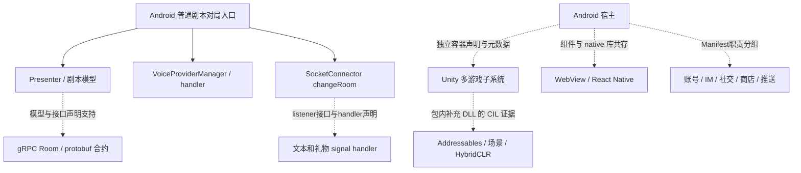

# 两款头部候选剧本杀 App：APK 与 REA 架构分析

调查日期：2026-10-12。已取得两个原始 APK，并通过 REA 完成静态模块与架构调查。**我是谜已取得业务方法证据；百变大侦探的加固包只恢复到声明、资源、加固入口和 Unity 子系统，普通剧本核心调用链仍未恢复。**

## 核心交互前端演示（追加）

已进一步解析百变 6.45.2 的资源表和 501 个相关布局，恢复原始控件名、资源 ID 与引用。现有 [可运行前端演示](demo/README.md) 可体验选角、私人读本、地图搜证、线索/笔记、多题投票和复盘；[本机预览](http://127.0.0.1:4176)。

[新增核心交互证据](analysis/baibian/core-interaction/interaction-contract.md)明确区分包内观察与演示设计。Java 加固后的权威规则仍未知，前端不会把模拟多人、原创案件或推进守卫冒充原产品实现。

## APK 与来源

| 应用 | 下载基线 | 包名 | 包体 | 来源 |
|---|---|---|---|---|
| 百变大侦探 | 6.45.2 / 564502；458,176,062 bytes | com.mszmapp.detective | [baibian-6.45.2.apk](apks/baibian-6.45.2.apk) | [官网](https://mszmapp.com/) → [官网指定应用宝入口](https://a.app.qq.com/o/simple.jsp?pkgname=com.mszmapp.detective) → 腾讯 APK CDN |
| 我是谜 | 3.50.9 / 281；295,755,729 bytes | com.wzf.fan | [woshimi-3.50.9.apk](apks/woshimi-3.50.9.apk) | [官网 HTTP 页面](http://www.woshimi.cn/) 的 JS 内安卓按钮 → xiyacs HTTPS CDN |

选择依据是“以线上剧本杀为核心的历史头部产品”，不是未经验证的 2026 最新市场排名。历史报告曾将这两款列作头部：[粤开证券报告](https://file.iyanbao.com/pdf/70938-02db24ce-5377-4972-a36f-2640453e1aa0.pdf)。当前 [TapTap 百变页面](https://www.taptap.cn/app/136635) 和 [小米我是谜页面](https://r.app.xiaomi.com/details?id=com.wzf.fan) 可佐证产品仍有相关发行与剧本杀定位。不同渠道版本不同；我是谜商店另列 3.51.1，本研究固定官网实际提供的 3.50.9，不声称是全渠道最新。

两个包均通过完整 ZIP CRC 检查；百变 MD5 与应用宝记录一致。没有独立官方签名证书基线，未宣称发行方签名已认证。官网 HTTPS 证书异常的细节和替代访问链见 [source-provenance.json](analysis/source-provenance.json)，未关闭 TLS 验证。

SHA-256：

- 百变：`8522e582689c462c2746ffad8dcf7190e98b52d6d93c79468a239005fe8d9fe3`
- 我是谜：`093a2df17162f9bdce8efefe66993b7e5928b3014d31af771b1fc2e520143f15`

## 主要发现

1. **客户端主结构是复合架构。** 剧本领域、房间、语音、社交、交易和独立小游戏分层，但“包里的多种框架”不等于每个框架都承载剧本核心。
2. **我是谜的普通对局采用原生 Activity / Presenter 与结构化剧本模型。** REA 读取 `GamingActivity.initData`，观察到创建 presenter、取得 `EnterRoomBean`、读取 `PlaybookConstant`、配置玩家和决定列表、注册语音 handler、调用 `changeRoom("game://" + roomId)`。这比 UI 文件名更强，但仍是静态调用证据。
3. **我是谜存在多条通信通路。** 房间/剧情操作有 protobuf 与 gRPC Room stub，已恢复选中提交投票订阅方法 → Room stub → gRPC ClientCalls 的静态链；SocketConnector 消息 handler 另处理聊天、礼物等信号。不能据此认定 Socket 承担全部权威房间状态，也不能直接推出后端微服务部署拓扑。
4. **语音具有客户端适配层。** 我是谜入口通过 `VoiceProviderManager` 获得 provider 与注册 handler，`changeVoiceProvider` 的 type 0 分支直接构造 `AgoraVoiceProvider`；百变原包则携带 Agora、Zego、网易 RTC、腾讯音视频相关 native 库。选中的 provider 和实际成功通话需要分别验证。
5. **百变包体有明确加固边界。** Manifest 声明普通对局、DM、AI 剧本、互动房等入口，但公开 DEX 主要是网易 wrapper；REA 反编译入口确认 native 加载和 Application 替换。不能用壳类数表示业务规模。
6. **百变 Unity 更像独立多游戏容器。** 元数据和 Addressables 配置包含飞行棋、五子棋、派对、台球、宠物等下载/场景入口。REA 对包内补充 `MonopolyLoca.dll` 的 CIL 确认 catalog 更新、依赖下载、场景加载及 HybridCLR metadata 加载；该 DLL 与当前 AOT 元数据布局有差异，不能保证原生入口执行同一版本实现。
7. **两包存在相同业务类命名。** 我是谜包名为 `com.wzf.fan`，但可反编译业务含 `com.mszmapp.detective.module.game.gaming.GamingActivity`，与百变 Manifest 同名。可观察到代码命名和产品架构相近；这不证明所有源码一致、共同后端或公司关系。

## 模块对照

| 模块 | 我是谜 3.50.9 | 百变大侦探 6.45.2 | 证据强度 |
|---|---|---|---|
| 剧本目录 / 详情 / 角色 | 业务模型、类目录、页面入口 | Manifest 的 playbook 模块、角色/详情/筛选入口 | 声明为主；我是谜可深入方法 |
| 读本 / 线索 / 场景 / 投票 | Room stub 及 protobuf 领域声明、Presenter/Activity 调用 | 原生对局声明与资源文案 | 我是谜部分方法可读；百变核心实现未知 |
| 普通 / DM 对局 | 原生游戏与主持相关类 | GamingActivity / DmGamingActivity 等分别声明 | 不能仅按相同类名迁移另一包的行为结论 |
| 房间同步与信号 | gRPC Room 合约、channel 初始化、Socket 信号 handler | Game/Wait service 与 NIM 声明；具体协议未知 | 非运行时捕获 |
| 语音 | provider manager / handler 静态调用；type 0 分支构造 Agora | 多 RTC 库与音频权限 | 库存在不证明选中路线 |
| 内容下载 | 见我是谜专项方法证据及模型 | 版本检查 / 下载 / 解压 / 解析资源提示；Unity有真实 CIL 加载边 | 普通剧本和 Unity 资源交付须分开 |
| IM / 社交 / 商业化 | 业务目录及 Retrofit 声明 | 账号、关系、俱乐部、IM、商店、DM订单组件 | 服务端审核 / 结算未验证 |
| 小游戏与扩展 | Unity IL2CPP 相关包体 | Unity、HybridCLR、Addressables、React Native、WebView | 动态内容和线上功能开关未知 |

## 架构视图

以下虚线表示职责分层推断；实线是我是谜选中方法里观察到的静态调用。矩形名称是分析标签，不是恢复出的全部原始源码模块。

普通剧本的建议理解路径是：内容目录 → 房间及角色配置 → 每位玩家的故事/线索/场景模型 → 对局呈现和动作提交 → 语音/聊天交流。这个路径用于组织分析，不能冒充完整恢复的协议时序。百变资源文字说明常见五阶段为阅读、自我介绍、集体搜证、相互询问、结案投票；这只是打包说明文字，不是所有剧本的强制状态机。

## 详细报告与可复核证据

- [我是谜：模块、接口、方法与限制](analysis/woshimi/findings.md)
- [百变：原生声明、加固入口、资源与模块地图](analysis/baibian/findings.md)
- [百变 Unity：程序集、资源交付和真实 CIL 调用](analysis/baibian/unity/findings.md)
- [下载来源与原包完整性](analysis/source-provenance.json)
- [REA Evidence 文件索引](analysis/evidence-index.json)
- [原始调查问题](analysis/QUESTIONS.md)

REA 版本 6.4.0；Android provider 为 headless JADX 0.7.1；复用现有 JDK / 引擎。CLI 完整 JSON 输出保存在对应分析目录。辅助 DEX/资源/IL2CPP 格式解析明确标为普通本地证据，不包装为 REA Evidence。

## 关键 REA 证据定位

| 结论 | 记录与 Evidence ID |
|---|---|
| 我是谜对局入口 / 模型 / 房间 / 语音调用 | `woshimi/method-GamingActivity-initData.json`：`ev_015b966068d76c03c5bc6cda5e0ec127b5b408b693b9a08d385658b749095abc` |
| 我是谜投票订阅 → Room stub | `woshimi/method-submitVote-caller.json`：`ev_af8b8ec761ce2a051edd366217fb871aa8131bc35a3de2ab4ae04987ec3bba58` |
| 我是谜 Room stub → gRPC | `woshimi/method-RoomStub-submitVote.json`：`ev_3f53f3a582e92ce83f9fe720ccc68e9476523c6c9a6182c9d7df1e2efc722c74` |
| 我是谜语音 type 0 → Agora | `woshimi/method-VoiceProviderManager-changeVoiceProvider.json`：`ev_b81e8027ec152037312a19dbd03ada58b991edc5bbbd6e24778af10df95ecc1d` |
| 百变 Manifest、包名与版本 | `baibian/package.json`：`ev_64fd7e6cf8a87d99729f37787ef61c3b3f208c1a43aa58d098672ff4edf6c300` |
| 百变加固加载入口 | `baibian/wrapper-attach.json`：`ev_9432c958da4416e6ee76f0b9404359133f733885f4cc59922ae11623f799683f` |
| 百变包内补充 DLL 资源交付调用 | `baibian/unity/rea-monopoly-members.json`：`ev_a776549dba3ea4ba9dd3f3aeb35c6d1828c806b25b36a7913d576be2f791eb6f` |

以上路径均相对 `analysis/`。APK 证据绑定原包 SHA-256；DLL 证据绑定成员 SHA-256，父包映射由提取 provenance 保存。Evidence 是静态观察，不能替代运行验证。

## 已完成与剩余未知

| 调查问题 | 状态 |
|---|---|
| 两个原包、来源、版本、hash、ZIP完整性 | 已完成；签名身份独立认证未完成 |
| 客户端模块及多运行时组成 | 已回答；具体功能可达性未知 |
| 我是谜普通对局模型及选中方法 | 部分回答，非完整调用图 |
| 百变普通/DM剧本业务调用链 | 未恢复，加固边界已固定 |
| 百变 Unity 资源交付与独立游戏组成 | 部分回答；包内DLL与当前AOT对应关系及远端内容未知 |
| 实际语音路线、实时协议、断线一致性、权限执行 | 未运行验证 |
| 后端服务、数据库、鉴权、结算、排名算法 | APK不足以建立完整结论 |

本次只做静态调查，未安装或运行 APK，未登录或加入房间，未请求包内业务服务或 Unity 远端资源，没有提交、推送或修改 REA 源码。原工作区的 SOUL / TaoTie / Werewolf 内容保留。
