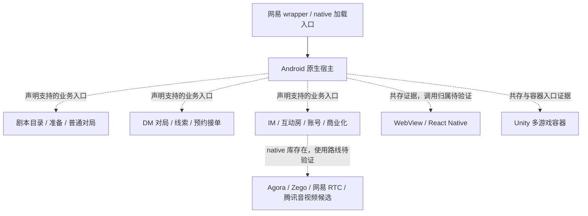

# 百变大侦探 6.45.2：模块与客户端架构

## 结论与覆盖

包内可以确认：这是一个包含 Android 原生业务入口、网易加固加载层、WebView、React Native 和 Unity 资源/运行库的复合客户端。普通剧本对局、DM 主持对局、互动房和 AI 剧本分别具有 Android 组件声明。Unity 进一步分析见 [unity/findings.md](unity/findings.md)。

**不能声称已恢复整个剧本杀调用链。** 原包 `classes.dex` 的原始定义只有 30 类，主要为网易 wrapper；JADX 解析目录报告 31 类，计数口径并列保留。Manifest 声明的 `GamingActivity` 不在可读静态类目录中，REA 精确读取返回 `Exact class not found`。业务方法的具体实现、阶段转移条件、HTTP/WebSocket 协议、选中的 RTC 提供商仍未知。

## 样本和证据

- APK：`../../apks/baibian-6.45.2.apk`，458,176,062 bytes。
- 包名 `com.mszmapp.detective`；版本 `6.45.2` / `564502`；minSdk 21、targetSdk 35。
- SHA-256：`8522e582689c462c2746ffad8dcf7190e98b52d6d93c79468a239005fe8d9fe3`。
- MD5 `fb4f30e3c2c20d2a4248255af53bf660` 与官网下载入口所引导的应用宝记录一致；ZIP 全成员 CRC 检查通过。这些检查不等于发行方证书身份认证。
- REA Manifest/identity：`package.json` → `ev_64fd7e6cf8a87d99729f37787ef61c3b3f208c1a43aa58d098672ff4edf6c300`。
- REA 包体检查：`archive-evidence.json` → `ev_8648e87908cbdb79d46103a132e46b902f27e38077c8d561a8f4552156a2ea4a`；其中 inventory 子证据 `ev_9852a76aaae2440b39b4ae7f452177ab0776dc387aa8611051bc6f61fc4f8113`。
- REA Android 图谱：`graph.json` → `ev_43ef67ae5bf0edc5c98982a3cab2ccb672c0228b89bc8967f2b6102f4f5dcfe4`。
- REA 加固入口方法：`wrapper-attach.json` → `ev_9432c958da4416e6ee76f0b9404359133f733885f4cc59922ae11623f799683f`。
- `artifact-index.json` / `dex-index.json` / `resource-strings.json` 是普通本地格式解析记录，**不是 REA Evidence**。Manifest 的后处理来自上述 REA 解码 XML，保留在 `manifest-components.json`、`module-declarations.json`。

## 业务模块地图

下面是 Manifest 声明和资源语义共同支持的职责分组，不等于原始 Gradle 模块、源码边界或运行时可达性证明。Manifest 共声明 368 activity、36 service、18 receiver、18 provider。

| 模块 | 包内直接观察 | 可以得出的结论 / 边界 |
|---|---|---|
| 启动与首页 | `module.spash.SplashActivity`、`module.home.HomeActivity`；Application 为 `com.netease.nis.wrapper.MyApplication` | 原生 Android 首页与加固启动入口；后续真实 Application 由加载层替换 |
| 剧本目录与详情 | `PlaybookLibraryActivity`、`PlayBookDetailActivity`、`PlaybookDetailV2Activity`、`PlaybookFilterActivity`、`PlaybookRoleActivity`、评论及排行入口 | 存在目录、详情、筛选、角色资料和内容评价入口；V1/V2 名称不证明两者同时启用 |
| 普通剧本对局 | `RoomHallActivity`、`RoomOrAppointmentListActivity`、`PrepareEnterActivity`、`PrepareReadingActivity`、`GamingActivity`、`ReadPlaybookActivity`；`GameStreamService`、`WaitStreamService`、`SingleGameService` | 准备/阅读/对局 UI 与 service 声明分离；service 是否承担网络、音频或保活需方法证据 |
| DM 主持带本 | `DmRoomHallActivity`、`DmPrepareEnterActivity`、`DmGamingActivity`、`DmMagnifyClueActivity`、`DmVideoPlayActivity`、预约及接单相关入口 | 主持模式具有独立准备、游戏、线索展示、音视频和订单入口 |
| 剧本下载与解释 | 字符串包括检查版本、下载、解压、解析、读取失败及重试；resource indices 15916、15938、15960、15972、15973、15981 | 包内 UI 文案承认分阶段内容获取流程；具体包格式、校验、缓存策略和重试实现未恢复 |
| 线索 / 角色 / 投票 | 私有线索公开提醒、角色交换/锁定、搜证、投票结果、复盘；详见下一节 | 有相应用户概念和交互文案；可见性规则和投票算法未由代码验证 |
| AI 剧本 | `AiPlaybookActivity`、`CaseDetailActivity`、`CaseChatActivity`；`lottie_ai_playbook_chat_loading.json` 等 | 有独立 AI 剧本入口和聊天呈现资产；模型供应商、Prompt、生成/判案机制未知 |
| 互动房 / 语音社交 | `LivingRoomsActivity`、`CreateLiveRoomActivity`、`RoomInfoActivity`、KTV、狼人等入口；多家 RTC native 库 | 多玩法互动房与剧本业务并存；不能仅凭库存在判断实际语音链路 |
| IM / 社交 | `NimService` / `NimServiceV2`、NIM providers、网易聊天 UIKit；好友、俱乐部、组队、私聊、师徒、关系等入口 | 包含网易 IM 集成声明；消息结构及其与对局同步的关系未恢复 |
| 交易 / 账号 / 推送 | WX 登录/支付、钱包/道具/商店、手机登录、实名认证、多个厂商推送声明 | 商业化和平台能力具有独立客户端入口；不建立服务端结算或审核保证 |
| Web / React / Unity 扩展 | `CommonWebViewActivity`、`module.react.ReactActivity`、Unity feature router / living / game Activities；Hermes/RN/Unity native 库与资产 | 多运行时共存，倾向原生宿主加可扩展呈现/玩法容器；各页面的真实运行时归属与路由尚未全部确认 |

Manifest 命名空间分组中 `info` 130、`game` 57、`live` 28、`playbook` 22、`cases` 22 个组件。它们是声明计数，不能当作活跃功能数量或架构复杂度指标。

## 剧本领域与阶段

普通资源字符串池提供以下可追溯文本：

| string index | 观察到的文本或语义 | 解释边界 |
|---|---|---|
| 15982 | 正常情况下五阶段：阅读剧本、自我介绍、集体搜证、相互询问、结案投票 | 包内说明文字；不是恢复的状态枚举，不代表所有剧本严格使用同一流程 |
| 14265 / 14290 / 17292 | 准备阶段 / 分配角色阶段 / 选择剧本阶段 | 游戏开始之前还有准备概念，但顺序、跳转条件未知 |
| 12947 | 公开笔记也会公开私有线索的提醒 | 文案表达隐私边界；实际权限执行位置未知 |
| 13223 | 主持安排抽卡；点击线索池获得线索；手牌确认后进入线索池 | 至少存在主持管理的线索池/手牌玩法说明，不证明所有剧本采用此机制 |
| 15375–15386 | 投票、结果、解散并退出、解散重开 | 要区分案件投票和房间解散投票，不能将所有 vote 当作同一领域事件 |
| 13813 / 15296 | 主持退出结束对局提醒 / 移交主持人询问 | 存在主持生命周期概念；接管、离线、重连实现未恢复 |
| 17247 / 17379 | 连接语音频道重试 / 重连 | 提示恢复能力，但不是重连成功或一致性证据 |

资源索引保留了原始成员 SHA-256、字符串序号和成员内 offset。此次仅解码 Android 全局字符串池；未完整解析资源 ID、引用与配置限定符。APK 的资源路径混淆，按可读 layout 文件名搜索得到零候选，不能解释为不存在对应页面。

## 加固加载边界：真正的方法证据

REA 反编译 `MyApplication.attachBaseContext(Context)` 得到：

1. 调用 `super.attachBaseContext(context)`，保存上下文与包名。
2. 视条件执行 native 库提取；尝试包装库加载，异常分支调用 `System.loadLibrary(strC)`。
3. 调用 `MyJni.load(this, packageName)`。
4. `newApp = a(context)`，随后 `MyJni.ra(context, newApp)`。
5. 后续有 `MyJni.cp()` 等调用。

这是加固启动层对 native 加载和真实 Application 替换的静态调用证据。`a(context)` 的完整解包/反射解析及 native 实现没有在本次恢复；不能声称壳后业务逻辑不存在，也不能把 wrapper 30 类当作全应用规模。

## 技术架构假设

图中 Shell 到 native 加载的调用有 REA 方法证据；其余虚线是职责关系假设。REA graph 产生的 278 个 managed/native bridge candidates 只是基于路径的配对，不是 JNI 调用链。本次未采用这些候选来证明业务连接。

## 未知与后续验证

未恢复普通/DM 对局方法、完整协议、角色/线索授权、投票校验、重连状态合并、RTC 路由及后端服务拓扑。若继续，需要独立可读发行渠道包或用户授权的隔离 Android 运行观察；当前研究未启动 APK。Unity 的 hot-update 目录同样不能证明远端现有内容或下载成功。Manifest 声明、资源文案、SDK 库存在均不能证明线上功能当前开放。
