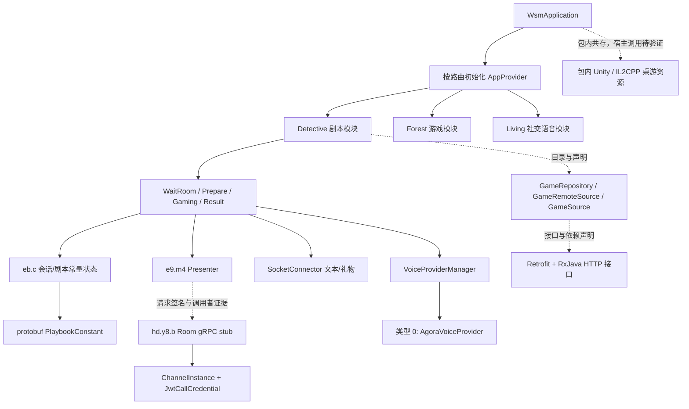

# 我是谜 Android 3.50.9：模块与架构静态逆向

分析日期：2026-10-12（Asia/Tokyo）。本报告仅描述所取得 APK 中的静态声明和聚焦反编译；未安装、启动 App，未登录、访问业务 API、创建房间或使用麦克风。

## 1. 样本和方法

原包：`Jubensha/apks/woshimi-3.50.9.apk`，295,755,729 字节。SHA-256：`093a2df17162f9bdce8efefe66993b7e5928b3014d31af771b1fc2e520143f15`。下载出处由上级调查的 `../source-provenance.json` 记录。本报告不额外认定来源具有签名授权。

REA 6.4.0 + JADX headless MCP 0.7.1，Java 26.0.1，单个 worker、4,096 MiB heap。所有 REA 操作直接针对原 APK，没有制造裁剪 APK 或改动原包。`package-escalated.json` 的 REA Evidence 为 `ev_36578da8652e269efdfe22bfefd819861a2edd75eab96dc26143ceb2b83d3a50`，确认包名 `com.wzf.fan`、versionName `3.50.9`、versionCode `281`、minSdk 21、targetSdk 35。REA 未验证 Android 签名。

REA 首次运行和设置缓存变量的重试都因 macOS Swift 进程所有权 helper 的编译缓存受到沙箱限制而失败，完整错误分别保留在 `package.json`、`package-retry.json`。通过已批准的沙箱外只读静态分析继续，未改配置、未安装工具。失败的类名选择器和搜索解析错误也原样保留，见 `evidence-ledger.json`；外层 `ok:true` 不能代替检查内部 data 的 Evidence 或错误 code。

普通 shell 补充证据：`index_apk.py` 以 ZIP/DEX 格式解析生成 `artifact-index.json`、`dex-index.json`、`retrofit-endpoints.json`、`game-protocol-inventory.json`。ZIP CRC 校验未发现失败成员；12 个 DEX 共 71,315 个原始 class_def，ZIP 11,663 个成员、432 个 assets、66 个 native library 成员（该包内 native 目录为 arm64-v8a）。REA/JADX 报告 34,651 个解析 class 和 11,663 个 resource。两个 class 数是不同生产边界的结果；原因未在本轮确定，不能将其视为等价计数，也不能据此宣称类全部成功反编译。

## 2. 最强架构结论

**观察：**核心剧本房间页面是原生 Android `GamingActivity` + 混淆 Presenter `e9.m4`，读取 protobuf `Playbook$PlaybookConstant`，通过 protobuf Room 请求及 gRPC stub 取场景、线索、角色、投票和能力；另有独立 SocketConnector 的文本/礼物信令旁路，以及 VoiceProviderManager 的 RTC 抽象。应用入口组合多个功能域。本轮取得的代码不能支持“整个产品是 Unity 客户端”的说法。

**推断：**这是“内容驱动剧本引擎 + 在线房间会话 + 社交/直播/商城平台”的组合。客户端保存剧本常量和当前 Room/Scene 信息，业务动作交给远端 RPC，页面按服务器场景/消息更新展示。服务端内部拓扑、权威规则实现、持久化和广播算法仍未知。

图中实线用于所选方法的调用或字段访问观察，虚线用于目录/签名和包体共存支持的模块关系；均未表现实际运行通信。

## 3. 模块拆分

| 模块 | 静态定位 | 观察与边界 |
|---|---|---|
| 宿主与组合 | `com.wzf.fan.WsmApplication.onCreate` | 初始化 MMKV、Glide、RichText cache、AppContext；按 `/detetive/AppProvider`、`/forest/AppProvider`、`/living/XiYaApplication` 调用 `init/apply`。拼写 `detetive` 为原始字面量。 |
| 剧本房间 UI | `com.mszmapp.detective.module.game.*` | WaitRoomActivity、PrepareEnterActivity、PrepareReadingActivity、GamingActivity、ReadPlaybookActivity、结果和评价 Activity 同时存在，表明等待、准备阅读、正式游戏、复盘等页面域。这里只恢复了 GamingActivity 的具体初始化行为；完整页面跳转规则未复原。 |
| Presenter | `e9.m4` | 目录显示 GetScene、GetClues、GetMyClues、GetSkills、GetFinalVoteResult、MakeDecision、SubmitCinematicSelection 等请求参数；持有 Game/PlayBook/User/Prop/Club Repository 和 Disposable。 |
| 内容常量和会话 | `eb.c` | 同时持有 PlaybookConstant、SceneInfo、CAUpdateRoomInfo、GetStoryResponse、地图/集合；`N0(PlaybookConstant)` 为直接赋值，不能把它称为解析器。 |
| 剧本数据模型 | `com.woshimi.larp.Playbook$*` | Character、Story、Scene、CluePack、Ability、Condition、Vote、Timer、Trigger、Cinematic 等 protobuf 模型；内容定义具备扩展玩法结构。 |
| 房间通信 | `com.mszmapp.detective.model.grpc.*` + `hd.y8.b` | gRPC Channel、Room stub、JwtCallCredential、Observer；Room stub 明确关联角色、场景、故事、线索、投票、能力、下载进度等请求。 |
| 大厅与内容 HTTP | `GameSource`、`GameRepository`、`GameRemoteSource`、PlayBookSource 等 | Retrofit 声明和 RxJava return type；HTTP 与 gRPC 同时存在。接口路径来自 DEX annotation，未实际调用。 |
| 文本/礼物即时消息 | `com.piaxiya.app.lib_base.socketconnect.SocketConnector` | 游戏页面加入 `game://roomId`，JSON type/action 信令转聊天列表和礼物展示；不是全部剧本状态推进链。 |
| 音频与 RTC | `VoiceProviderManager`、`AgoraVoiceProvider` | 实际方法在 provider 类型 0 时构建 AgoraVoiceProvider，并设置录音、混音、耳返、播放音量。 |
| 社交/其他游戏 | `com.xj.talkchatroom`、`com.wzf.userinfo`、`com.wzf.square`、`com.woshimi.tabletop`、`com.game.forest_game` 等 | 仅包/资源层模块候选，未按每个业务域反编译。 |

宿主包名是 com.wzf.fan，而剧本业务为 com.mszmapp.detective；同包还含 com.piaxiya.app.lib_base、com.woshimi.larp、com.wusheng.soa 等命名。可观察到这些模块共存和调用，不能从命名推导并购、授权关系或两款应用完全共用源码。

## 4. 剧本、角色、线索、投票和阶段

### 4.1 内容模型：剧本是可组合的数据结构

`Playbook$PlaybookConstant` 的 REA 类目录含角色、角色故事、线索包与线索能力、场景、地图、位置、投票、能力、条件、触发器、timer、cinematic、build 和配置等 accessor。

Evidence：`ev_d03f1010c6a7e20ca86a2196cd5dbd0a3f9efe4d43b44595c0af40b2f3d61176`，`class-PlaybookConstant.json`。

补充 DEX 模型声明（普通 shell，`game-protocol-inventory.json` / `protocol-summaries.txt`）：

- CharacterInfo 有角色 ID、性别、年龄、角色描述与 image；CharacterStory 将角色与故事列表关联。
- Clue 有 parent、distributeSceneId、relatedClueIds、tags、videoUrl、foundSoundAffect。CluePack 有 visibleCondition、enable、所在位置和禁止互动角色列表。
- MetaAbility 有使用条件、可见条件、triggerActions、全局/按目标限次、CD、是否被动、解锁成本；Condition/AbilityAction 带参数 map。
- MetaVoteList 支持 publicVotes/privateVotes、timeLimit、final、delayShowResult、manuallyShowResult；MetaVote 有 option、answer、score、strategy、style、结果展示参数。
- BuildInfo 有 engineVersion/minimalParserVersion；PlaybookConfig 有最小/最大玩家数、supportSnapshot、隐藏线索/技能/故事按钮。

**推断：**它不仅支持固定“读本—搜证—投凶”，还预留条件、技能、地图、分支选择、角色属性和受限能力。但模型存在不证明每个机制在当前所有剧本中启用，也不证明这些规则在客户端还是服务端完整执行。

### 4.2 页面进入和状态所有者

`GamingActivity.initData()`：构建 `new m4(this)`；从 Intent 读取 EnterRoomBean，记录 roomId、roomTitle、是否首入；取 VoiceProvider 的 handler、设置本机静音展示；若 SocketConnector 未绑定房间则 `changeRoom("game://" + roomId)`；调用 presenter 和 `eb.c.L()` 保存房间；识别 isWatcher；初始化 PlayersAdapter；读取 `eb.c.L().E()` 的 PlaybookConstant，为空则以“无法获取角色信息”错误退出；创建 DecisionAdapter/DecisionCenterAdapter。

Evidence：`ev_015b966068d76c03c5bc6cda5e0ec127b5b408b693b9a08d385658b749095abc`，`method-GamingActivity-initData.json/.java`。

`eb.c` 的类型目录将“剧本常量、场景、房间动态信息”明确区分。Evidence：`ev_cd001f21a64ffaefe6e65f74202dc206ea1f8fd7fcccb43bcf36e9efe57575da`。Presenter 的目录 Evidence：`ev_bc1e498bf1abacc79bcf53f81c120c3f698d6e36420a4aef2f49e3980a6b91e5`。

### 4.3 角色、读本和搜证 RPC

Room stub `hd.y8.b` 对应方法：

- `m(ChooseCharacterRequest, observer)`：选择角色；`W(SetExpectedRoleRequest, observer)`：期望角色；`Z/a0`：换角请求与答复。
- `I(GetStoryRequest, observer)`：取故事；`y(GetPlaybookBasicInfoRequest, observer)`：基础剧本信息。
- `t(GetCluesRequest, observer)`、`v(GetMyCluesRequest, observer)`、`A(GetPublicCluesRequest, observer)`：线索、个人线索、公共线索分别获取。
- `s(GetClueAbilityListRequest, observer)`、`x(GetPlaceAbilityListRequest, observer)`、`H(GetSkillsRequest, observer)`、`d0(UseAbilityRequest, observer)`：搜证/位置/技能动作并非单一客户端枚举。
- `E(GetSceneRequest, observer)`、`F(GetSceneListRequest, observer)`：当前场景和场景列表。

Evidence：`ev_b86fa902c65ffaa1c89a8178b57094114f0e085001bf719d505facedad3a940c`，`class-RoomStub-dot.json`。这是 provider signature 目录，不是全部按钮到请求的调用图。

`e9.m4.k0(GetSceneRequest)` 具体通过 `Observable.create(new a0(request)).compose(io_main()).subscribe(new z(activity))` 取场景并将异步响应送到页面。Evidence：`ev_621ca0655890d9b2d9458a45b51f81b342db49467b734a18a1c4736cf1fc65a5`。

SceneInfo 的 REA 目录含 `step/timeline/status`、BGM、places、characters、resource、hasVote、finalVote、showTruth、showEndComment、voteListId、control。Evidence：`ev_5c049c25184ddb4bdbbf203f1e3de36ec7cf681f7b9cf377a78d03162fecc18e`，`class-SceneInfo-dollar.json`。由此可推断阶段显示由场景状态驱动；**没有恢复每个阶段跳转条件、房主推进权限或所有客户端 action 分发，不列出已证实的完整阶段状态机**。

旧 `com.wusheng.soa...PlayCommon/PlayParam` 协议另有 confirmNext、callVoteNextChapter、extractClues、intoGame、NavigationType 等定义，仅为 DEX 声明观察。不能假定其在该版本主流程仍处于使用状态。`E_GameStage.<clinit>` 的 REA 输出 body_status=not_available，没有恢复枚举值实现，Evidence `ev_9c1a4c4a0b01f7c132308cb9ed3a800200ca8871a08b5758642ffcd8e7cfcc00`。

### 4.4 投票具有可验证的实际调用边界

`hd.y8.b.Y(SubmitVoteRequest, observer)` 内调用 `ClientCalls.b(channel.h(y8.Q(), options), request, observer)`。Evidence：`ev_3f53f3a582e92ce83f9fe720ccc68e9476523c6c9a6182c9d7df1e2efc722c74`。

REA incoming references 将 Y 的调用者定位到 `pa.c.d.subscribe`；该方法创建 GrpcStreamObserver、登记 observer，然后调用 `StubCreater.getRoomStub().Y(this.request, observer)`。Evidence：`ev_e9ac43ff386a1af8df02f43fa07646d0560df8c53535ee0d2071ab947e3d7e62`（静态引用）和 `ev_af8b8ec761ce2a051edd366217fb871aa8131bc35a3de2ab4ae04987ec3bba58`（调用者反编译）。这比仅看到“Vote”字符串更强，但仍未复原 UI 到 request map 的全部生产过程。

## 5. 通信、语音和内容加载

### 5.1 HTTP + 房间 gRPC + Socket 信令分工

GameSource 的类目录由 REA 观察（`ev_2ec3292adfe2d807441be1dd0501a27f4382b188e5906f9f6e478056ed6f3df0`），HTTP 路由来自普通 DEX Retrofit annotation：`/room/create`、`/room/join`、`/room/{id}/detail`、`/game/lobby`、`/router/grpcendpoint/{roomId}`。有按房间查询 RPC endpoint 的声明，可推断房间连接参数并非只有单一硬编码入口。

`ChannelInstance.initManageChannel` 保存 host/port，构造 UA，按 environment 选择 TLS 和 certificate resource；生产分支传入 assets/raw certificate 到 build。Evidence `ev_58f9373b58ba5687b5122c0dbb4d697145c7fb3d97876be3c7c5cc2763a67454`。本轮没有反编译 build 以审计证书验证，不宣称 TLS 配置安全或证明 pinning。

`StubCreater.getRoomStub(int)` 对 Room stub 附加 JwtCallCredential（静态代码拼接 Bearer + 用户 ID + 冒号 + token）；无参数版本默认传入 6000 ms，并尝试设置 deadline。Evidence `ev_576f6d56a3275a51f13cd8c91ca80e0250a285cbc8d8bb4e2ab7ae4980af5148` 和 `ev_ce35a062f0632116f0206fced5ac56a4ea0787f068d55fdd714762cec6c1fd4b`。没有真实 token 或账号被读取。

`SocketConnector.startConnected` 清理已有 socket，按环境选择 URL、订阅 socketSubscriber、启动 heartbeat timer。Evidence `ev_d8800c421c18f76e66c37af85a818af2ba048771e1be4c9d73c54db0eb87cdcd`。`GamingActivity.onReceivedSignalMsg` 按 JSON type/action 过滤；action=3 转 DramaGiftData 更新礼物及聊天条目，其他分支转 DramaMessageBean，处理 VIP icon、nickname、chat_bubble、color，更新聊天列表。Evidence `ev_0298c19cd41811b3b4abae83f167741d2277906bdc85ecf9472428d8dbaca4ec`。不能把这个聊天 handler 说成剧本步骤推进器。

### 5.2 实际 RTC 路由

`VoiceProviderManager.changeVoiceProvider` 在类型变更时退出旧 provider；当 provider 为空且 type=0 时创建 `AgoraVoiceProvider`，设置 record/audioMixing/earMonitoring/playback 音量。Evidence `ev_b81e8027ec152037312a19dbd03ada58b991edc5bbbd6e24778af10df95ecc1d`。

结合 GamingActivity.initData 的实际 provider handler 调用，已确认剧本页接入这一语音抽象，已确认该路由的 type 0 实现是 Agora。包内也有 AliRtc SDK、RTCConfigZego/YouMe 等模型候选，但本轮没有观察其在当前剧本房间被选用，不把“SDK存在”写成“实际使用所有服务商”。真实 RTC channel、服务端 token 下发、麦克风权限和通话质量未验证。

### 5.3 下载与内容解析覆盖

`AppDownloadHelper.execute` 使用 Retrofit+Gson+RxJava2+OkHttp 创建下载 service，IO scheduler 读取 ResponseBody.byteStream，以 8,192 字节缓冲写文件；按内部存储或 Android API 分支选择 FileOutputStream/MediaStore，处理 cancel、onStart/onError/onComplated。Evidence `ev_21b4ae756d2eac1c404c67a0c191a31cafd491b9036a46548d6d869c0abd4627`。这是实际下载基础设施代码，**尚未证明某一剧本 package 的所有下载都走该 helper**。

DEX 的 Single.CheckPlaybookResponse 含 url/url2/version/password/needUpdate；Room.UpdateDownloadProgressRequest 含 roomId/playbookId/progress/isDone；Room stub b0 明确接受该请求。说明协议设计有剧本版本检查、外部包下载参数和房间进度同步。这仍是协议声明观察，未下载剧本付费内容或解析真实剧本文件。

目前未追到“下载完成→解压/解密→parse protobuf→装入 eb.c”的完整生产链。`eb.c.N0` 只是保存 PlaybookConstant。为保留调查过程，`method-GameState-parsePlaybook.json` 原名虽然包含 parsePlaybook，实际 `eb.c.o0(byte[])` 是 RIFF/WEBP 头检测；`method-GameState-loadCandidate.json` 实际 `eb.c.u(String)` 是集合 contains。它们**不是**剧本 parser/loader，不能根据调查时的文件名推导结论。

## 6. SDK / native / Unity 观察

普通 ZIP/DEX inventory 显示：Agora RTC/RTM、Hyphenate IM、Retrofit、OkHttp、RxJava、gRPC、protobuf、MMKV、Glide、SensorsData、Umeng、Bugly、华为/小米推送等 namespace/native 成员。除上文具体方法已直接验证的部分，其余仅能说被打包，实际初始化和数据流未审计。

包内有 libunity.so、libil2cpp.so、libgrpc_csharp_ext.so、assets/bin/Data/Managed/Metadata/global-metadata.dat，以及 Android/Standalone 平台 DLL 资源（Unity.Addressables、Unity.Netcode、MonopolyLoca、Google.Protobuf、QFramework 等）。这强力证明 APK 中有 Unity/IL2CPP 子系统；对应 tabletop 等域为合理推断。没有对 IL2CPP native code 做反编译，不把桌游的 Unity 实现归到已验证的 native Detective 剧本页面。

## 7. 覆盖与未知

已回答：样本身份/Manifest、模块分布、核心页面/Presenter/会话所有者、剧本 protobuf 模型、Room RPC 目录、具体投票调用、场景请求、Socket 聊天礼物、语音 provider type 0、下载基础设施、Unity 子系统存在。

部分回答：等待→准备→阅读→搜证→投票→复盘的完整页面/阶段序列；角色/线索可见性；下载/版本检查/剧本解析完整链；实时 room stream 的全部 action。

未知或未验证：APK签名可信性、全部DEX与native行为、反射/动态代码路径、服务端源代码和基础设施、活跃接口域名与实时协议抓包、实际权限/安全策略、使用者规模与头部排名、真实多人流程和通话表现。本报告不能用于断言这些方面已验收。

`evidence-ledger.json` 提供每个完整 JSON Evidence 的文件、操作、参数、Evidence ID 和失败 code。`.java` 为成功 REA normalized source 的便读副本，权威记录仍为对应完整 JSON。原 APK 和记录均未提交。
