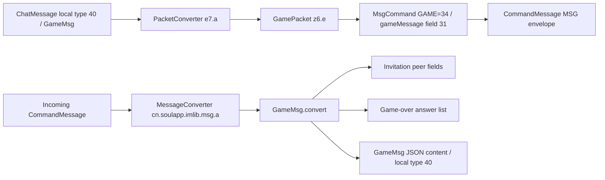

# DrawSomething / 你画我猜 reverse-engineering result

Target: supplied international Soul 2.78.0 XAPK, SHA-256 `071b2f441a1eff7b96a063fce4ed8b0c9415797da98d7037284649f26db797c1`. This pass recovered the exact packaged game schema and decompiled its IM adapters. It did **not** establish a complete playable drawing-game implementation or voice-room integration in this build.

## What was recovered

- Complete embedded `draw-something.proto` FileDescriptorProto, with exact field numbers/types, enum values, map types, oneofs, code-generation options, and proto3 syntax.
- Reconstructed compilable `draw-something.proto`; descriptor semantic equivalence verified against original bytes.
- Decompiled client GameMsg conversion, outgoing GamePacket, packet factory, and base IM wrapper construction.
- Incoming, outgoing and stored-message type mappings, with supported phase branches.
- Five offline synthetic protobuf examples with byte-preserving encode/decode round trips.
- Bounded inventories of class references, resources, Flutter names and native strings to identify missing UI/stroke/game engine evidence.

Schema recovered from the shipped descriptor is high-confidence. Decompiled Java is reconstructed output, not original source. Declared game states support a protocol model; they do not prove the server enforces any specific transition sequence.

## Exact schema and command vocabulary

`GameMessage` fields: `id:string #1`, `gameId:string #2`, `type:enum #3`, `phase:enum #4`, `extMap:map<string,string> #10`. A `cmd` oneof selects ping #5, invite #6, ready #7, play #8, or gameover #9.

- Game type: GENERAL=0, DRAW_SOMETHING=1.
- Phase: PING=0, INVITE=1, READY=2, PLAY=3, GAMEOVER=4.
- Invite: inviter:string #4, invitee:string #5, extMap #6.
- Ready: READY=0 or NOT_READY=1; extMap #6.
- Play: oneof contains DrawSomethingPlayGameMessage #5.
- DrawSomething play fields: round:int32 #3, maxRound:int32 #4, action type #5, question:string #6, questionDesc:string #7, answer:string #8, answerDesc:string #9, extMap #10.
- Actions: QUESTION_SET=0, ANSWER_SET=1, DRAW=2, GUESS=3, TIMER=4.
- AnswerResult: question:string #3, questionDesc:string #4, answer:string #5, answerDesc:string #6, right:bool #7, ts:int64 #8, extMap #9.
- Gameover embeds an AnswerResults wrapper containing repeated AnswerResult #1.

`GamePsh` is a separate push schema. Its type DRAW_SOMETHING is **0**, unlike GameMessage.Type.DRAW_SOMETHING=1. Its command oneof contains DrawSomethingGamePsh #5. That message selects invite-done, ready-done, question-set-done, answer-set-done, round-start, round-done, gameover, or answer-result. Round notifications carry round/nextRound:int32 and ts:int64, with string maps.

Login/account/token/version and question/answer/game-ended errors are declared. No RPC service, URL, handshake, deadline, round limit, scoring function, answer comparison rule, or drawing codec is specified by this descriptor. Timestamp type is exact; timestamp meaning/units are not established by the game descriptor alone.

Full schema: [draw-something.proto](draw-something.proto). Original descriptor/provenance and writer-call corroboration: [PROTOBUF-RECOVERY.md](PROTOBUF-RECOVERY.md).

## Reconstructed client integration



These arrows describe observed static calls/conversions, not captured traffic or observed UI execution.

### Outgoing messages

[packet-factory.java](packet-factory.java), decompiled `e7.a.a(ImMessage)`, uses chat message type **40** to create `z6.e` (GamePacket). Wire type is **MsgCommand.Type.GAME=34**; do not confuse local40 with wire34. The wrapper includes peer addressing and general chat metadata, providing evidence of an IM path rather than a discovered room broadcast path.

[transport-z6-e.java](transport-z6-e.java), `z6.e.<init>` in classes2.dex (code item offset 2296272):

1. Constructs GameMessage, sets its id from the enclosing local message ID argument, sets gameId, and maps local game type1 to DRAW_SOMETHING.
2. For phase1, sets INVITE, builds inviter/invitee, and copies the local top-level extMap into the invitation map when nonempty.
3. For phase4, sets GAMEOVER but does **not** populate the gameover answer-results payload in this constructor.
4. Copies top-level extMap via the common map helper; places the game message in MsgCommand and finalizes the outer wrapper.

**Important coverage boundary:** this adapter has no branches populating PING/READY/PLAY payloads. Supplying local phase2 or phase3 would not automatically produce the recovered protocol's READY or PLAY message here. Those messages are declared in the schema, not supported by this particular adapter. Another implementation might exist remotely or in a different build, but none was established in the inspected class-reference paths.

[message-packet-base.java](message-packet-base.java), `z6.h`, constructs MsgCommand addressing/type/metadata, sets outer CommandMessage.Type.MSG, and finalizes it with message content, a helper-derived command signature, and `System.currentTimeMillis()`. Signature semantics, authentication, socket framing and live endpoint were not recovered in this game-focused pass. No account credentials were inspected or used.

### Incoming and persisted messages

[message-conversion.java](message-conversion.java), `cn.soulapp.imlib.msg.a.c`, dispatches wire GAME to helper `i`, which sets local chat type40 and calls GameMsg.convert. A database conversion branch also deserializes stored type40 JSON into GameMsg.

[GameMsg.java](GameMsg.java), `GameMsg.convert(CommandMessage)` in classes2.dex (code item offset1410892):

- Uses outer `CommandMessage.cmdId` as the local id; reads gameId and top-level extMap from the nested game message.
- For INVITE, copies inviter/invitee and invitation extMap.
- For GAMEOVER with game type1, extracts repeated answers with question/description, answer/description, correctness, timestamp, and extensions.
- Maps game type1 to the local type field.
- Does not populate ready/play models. For other phases, its phase field remains the Java default0 in this method.

Local GameMsg contains only invitation and gameover payload members alongside ids/type/phase/extMap. This is materially narrower than the complete protobuf vocabulary. It is consistent with an IM integration for invitations and result sharing; it does not prove where actual gameplay runs.

## Exact outer IM envelope

The embedded `im.proto` descriptor was also recovered and validated: [envelope/im.proto](envelope/im.proto). The game payload path is:

```text
CommandMessage: type MSG=0 (field3)
  msgCommand (field5, cmd oneof)
    MsgCommand: type GAME=34 (field1)
      gameMessage (field31, msg oneof)
        GameMessage: type DRAW_SOMETHING=1
```

MsgCommand also declares from:string #2, to:string #3, timestamp:int64 #4 and extMap:map<string,string> #30. CommandMessage declares cmd_id:string #2, crc:string #19 and timestamp:int64 #25, alongside other identity/transport metadata. Their values and population rules are not inferred merely from declaration. MSG=0 may be omitted in proto3 wire bytes. Full schema compilation against the recovered game dependency and full descriptor comparison passed. See [envelope/ENVELOPE-RECOVERY.md](envelope/ENVELOPE-RECOVERY.md).

This supplies an offline decoder for both the inner game message and the outer protobuf envelope. Socket framing/compression/encryption, service endpoints, and handshake remain separate unknowns.

## Gameplay state model: supported versus inferred

The schema declares this vocabulary:

`INVITE → READY → PLAY(question/answer setup, DRAW/GUESS/TIMER, round pushes) → GAMEOVER(answer results)`.

The ordering above is a **candidate protocol model**, derived from names and fields. The APK establishes invitation and game-over IM adapter behavior; it does not establish transition validation, whether both peers draw, turn ownership, question selection, timeouts, round progression, score accumulation, reconnect recovery, spectators, or backend authority.

Oneof semantics allow only one command payload per message. They do not enforce consistency between the separate phase/type enums and selected payload. Consumers must not assume the descriptor itself validates that relationship.

## Missing drawing implementation

No dedicated points/strokes/brush/color/width/image field is declared for DRAW. `DrawSomethingPlayGameMessage` has only the typed fields listed above and string maps. Possible drawing carriers include encoded map/string payloads or a separate transport, but **no used key or encoding was established**. Do not invent an `extMap["strokes"]` contract.

No named drawing-game screen, canvas handler, question bank, gameplay URL, active GamePsh consumer, or voice-room attachment was located in the bounded searches. Generic photo-editing `DrawingBoardView` and framework drawing functions were checked as false positives and have no established game linkage.

A direct-reference scan traversed **328,960 code-bearing methods across all nine DEX files**, with complete instruction-width traversal and no unsupported-opcode failures. It retained matching method/type/field/string references in `references.json` and `external-references.json`. This is a lexical/static incoming-reference scan, not a complete whole-program call graph: reflection, native callbacks, dynamic loading, server-delivered H5 and obfuscation outside selected markers remain unresolved.

Exact DrawSomething markers were limited to classes2 IM adapters and classes8 generated schema declarations. No equivalent marker was found in the inspected compiled resource strings, Flutter named library/class/field inventories, or printable strings in the 39 ARM64 libraries. Full bounds and false positives: [ui-report.md](ui-report.md).

## Offline usage and validation

The `.proto` is usable for decoding independently identified inner payloads:

```sh
/opt/homebrew/bin/protoc \
  --proto_path=/Users/mark/Projects/REA/SOUL/analysis/drawsomething \
  --decode=GameMessage \
  /Users/mark/Projects/REA/SOUL/analysis/drawsomething/draw-something.proto \
  < game-message.bin
```

Use `--decode=GamePsh` only when the payload is identified as that type. An entire socket frame or outer CommandMessage is not the inner GameMessage. Decode the wrapper/framing first; do not choose a message type based solely on whether protobuf parsing succeeds.

[examples/validation.json](examples/validation.json) records five **synthetic, offline** invitation/readiness/guess/round-start/gameover examples. They are not captured SOUL traffic, valid user IDs, or a claim of server acceptance. Each was encoded, decoded and re-encoded byte-identically, including Unicode answers and int64 timestamps. Readiness/guess examples demonstrate schema capability, not supported outgoing behavior of z6.e.

Compiler validation: protoc35.1 passed; recompiled descriptor matches the packaged descriptor semantically, with declaration order normalized and synthesized modern json_name omitted from comparison. Source comments/formatting are reconstructed. JADX1.5.6 decompiled the five selected classes without reported method errors, using the existing Homebrew OpenJDK26. Tool ZIP checksum matched GitHub release metadata; config/cache/output were scoped to this analysis folder. No system JDK installation was needed.

## What can be reconstructed now

**Available:** exact game protobuf codec, invitation/result message adapters, transcript/result viewer, synthetic protocol fixtures, and a separately specified test game backend/client using the recovered message vocabulary.

**Not yet available:** faithful original drawing renderer/codec, authoritative multiplayer state machine, scoring/question library, live server interoperability, or room/voice integration. Building those today would require explicit design choices, not recovered SOUL behavior.

For faithful gameplay reconstruction, the next decisive evidence is a build/session with the actual game entry visible. Follow its launch route and content download, identify drawing payloads and transport, then observe consenting test-player readiness/turns/drawing/guesses/results. Compare those records to the exact schema before implementing missing rules. The present international APK alone did not supply that full implementation.
