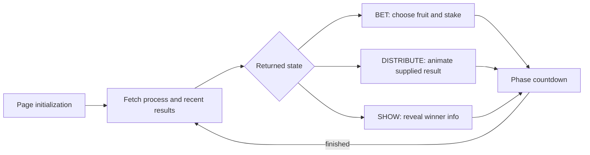

# SOUL Flutter gameplay flow recovery

Static ARM64 AOT analysis of the supplied international SOUL 2.78.0 package. No app launch, login, network capture, or backend request was performed. The recovered Dart is machine-oriented pseudocode, not original source or a runnable reconstruction.

## Recovery confidence

The standalone dae v0.1.13 run selected a Dart 3.6.1 snapshot profile by snapshot hash, while shipped libflutter advertises Dart 3.6.0. The profile is UNVERIFIED. This makes field/type annotations candidates requiring corroboration. In particular, `objs.txt` emits nonsensical superclass names for enum objects; those superclass labels were ignored. Important branches, loads, arithmetic, call targets, and bridge construction were checked against the original libapp.so using `/usr/bin/objdump -D --triple=aarch64`. Saved independent disassembly: [flow-byte-validation.txt](flow-byte-validation.txt).

## Fruit Land: recovered client round lifecycle

The enum objects carry UNKNOWN=0, BET=1, DISTRIBUTE=2, SHOW=3. See [enum objects](recovered/text/objs.txt). Dispatch code at **0x4d26ec** independently confirms values 1,2,3 call the betting, distribution, and reveal handlers. The constants 2 and 6 in parts of assembly are tagged Dart small integers (1 and 3), not additional states.

This is a reconstructed client control flow, not an observed backend lifecycle. Transitions are refreshed from process responses; the client does not simply increment the enum locally.

| Function and address | Supported behavior | Source |
|---|---|---|
| GameFruitPageState.initState **0x4d1b60** | Registers coin-charge success listener, fetches process and total coins | [page](recovered/dart/soul_flutter_international_biz_game_page_game_fruit.dart) |
| GameFruitNotifier.getCurrentProcess **0x4d1c04** | Resets selection/result UI and local bets; fetches current process and recent results | [notifier](recovered/dart/soul_flutter_international_biz_game_notifier_notifier_game_fruit.dart) |
| Process response closure **0x4d249c** | Copies response state/process, reconciles returned user bets by item, dispatches phase, notifies UI | [notifier](recovered/dart/soul_flutter_international_biz_game_notifier_notifier_game_fruit.dart) |
| checkProcessState **0x4d26ec** | BET -> **0x4d31cc**, DISTRIBUTE -> **0x4d2c2c**, SHOW -> **0x4d2790** | [notifier](recovered/dart/soul_flutter_international_biz_game_notifier_notifier_game_fruit.dart) |
| handleBetProcess **0x4d31cc** | Countdown seconds = ceil((totalBetMs - currentMs) / 1000) | [notifier](recovered/dart/soul_flutter_international_biz_game_notifier_notifier_game_fruit.dart) |
| handleDistributeProcess **0x4d2c2c** | Countdown = ceil((totalBetMs + totalDistributeMs - currentMs) / 1000); if <2s snaps to supplied currentResult, otherwise animates | [notifier](recovered/dart/soul_flutter_international_biz_game_notifier_notifier_game_fruit.dart) |
| handleShowProcess **0x4d2790** | Countdown = ceil((totalMs - currentMs) / 1000); can show winner dialog when round identifier/context/lifecycle checks succeed | [notifier](recovered/dart/soul_flutter_international_biz_game_notifier_notifier_game_fruit.dart) |
| onFinished **0x5e9b88** | Refreshes process | [notifier](recovered/dart/soul_flutter_international_biz_game_notifier_notifier_game_fruit.dart) |
| release **0x41a46c** | Cancels countdown, disposes animation controller; callbacks have active/lifecycle guard | [notifier](recovered/dart/soul_flutter_international_biz_game_notifier_notifier_game_fruit.dart) |

Field identities come from the recovered model field index and response parser, corroborated by tagged-object loads: [fields](recovered/text/fields.txt). The floating constant loaded in all three handlers is IEEE754 **1000.0** (`0x408f400000000000`, pool +0x11c30). These are server-supplied elapsed/duration values, not recovered fixed round lengths.

### Bet and result presentation

`betFruit` **0x41d59c** requires BET state and positive coin amount, then displays a confirmation alert. Its confirmation closure **0x41e224** maps the selected presentation index to a lottery/item index and calls `GameApiService.betFruit` **0x41e31c**. The success closure **0x41e794** updates matching local bet coin information, notifies UI, refreshes coin balance, and displays a success toast. [Bet guard and confirmation](recovered/dart/soul_flutter_international_biz_game_notifier_notifier_game_fruit.dart), [confirmation closure](recovered/dart/soul_flutter_international_biz_game_notifier_notifier_game_fruit.dart), [success closure](recovered/dart/soul_flutter_international_biz_game_notifier_notifier_game_fruit.dart).

`startLotteryAnimation` **0x4d300c** constructs a StepTween ending at `16 * (remainingSeconds - 2) + currentResult`, and an animation Duration of `remainingSeconds - 1` seconds. The animation listener **0x4d4090** evaluates the tween, takes the low 3 bits (`& 7`), maps it back to the displayed item index, and updates the highlight. `getItemIndex` **0x4d4130** bounds outcomes to 0..7 but scans a 9-entry display mapping. This strongly supports an eight-outcome selection presented in a nine-cell layout; the actual mapping array contents were not independently decoded here. [Animation](recovered/dart/soul_flutter_international_biz_game_notifier_notifier_game_fruit.dart), [listener and mapping](recovered/dart/soul_flutter_international_biz_game_notifier_notifier_game_fruit.dart).

**The inspected code animates a result already supplied in the process model. No local outcome RNG or server settlement algorithm was recovered.** That conclusion is limited to these inspected client functions.

`randomRequestWinnerInfo` **0x4d2de0** checks `currentTimes > 0` and `resultRemainMs > 0`, clears cached winner info, and delays the winner request by `resultRemainMs` milliseconds. Internally it multiplies by 1000 to construct Duration microseconds; despite the function name there is no random number generation in this function. Delayed closure **0x4d2ef8** calls `getGameFruitResultDialog` **0x4444d0**. [Delay](recovered/dart/soul_flutter_international_biz_game_notifier_notifier_game_fruit.dart), [request closure](recovered/dart/soul_flutter_international_biz_game_notifier_notifier_game_fruit.dart).

### Countdown semantics

`CountDownTimer.start` **0x4d2ab0** cancels the previous timer, stores the seconds, immediately calls the timing listener, and starts a periodic timer with a **one-second** Duration (pool +0x2410 = 1,000,000 microseconds). Tick closure **0x4d2b80** decrements first; negative values call finish then cancel, otherwise it calls onTimed. Thus zero is emitted as a timing value; finish occurs on the following negative tick. The listener calls at **0x4d2b24**, **0x4d2bd8**, and **0x4d2c10** are dynamic dispatches; their notifier interpretation is corroborated by recovered onTimed/onFinished methods, not claimed as direct machine call edges. [Timer](recovered/dart/soul_flutter_international_common_utils_count_down_timer.dart).

## Flutter/native room bridges

`VirtualParty` exposes two recovered methods in this snapshot:

| Channel | Method/address | Map keys | Caller traced |
|---|---|---|---|
| `channel_virtual_party` | `sendTextToParty` **0x3a8d40** | `roomId`, `text` | Lucky bag page closure calls it at **0x3a8ce0** |
| `channel_virtual_party` | `inviteUserToParty` **0x42066c** | `roomId`, `userIdList` | PartyInviteNotifier invokes at **0x420650** |

[Bridge construction and methods](recovered/dart/soul_flutter_international_common_plugins_virtual_party.dart). Both validate nonempty values before constructing the map and calling `ChannelNative.call` **0x3a8288**. These methods are room actions; this is not a complete RTC bridge. Native Android remains the owner of audio/seat operations unless separately established. The companion DEX analysis of `Lok/a;` reports an important asymmetry: the native `sendTextToParty` handler reads only `text` and invokes `VirtualPartyService.sendRoomText(text)`, although Dart sends `roomId` too. Therefore the sent `roomId` is not proven to select the destination; use of the current room context is an inference. See [native bridge evidence](../gameplay-schemas.md) and its JSON evidence for code-unit/file offsets.

The game page also registers **`soul.event.business.charge_coin_success`** through `SOEventBus.addEventListener` **0x4d3338**. The event channel is **`soul_channel_event`**; subscription/removal maps use `eventName` and `invokeMethodName`; callbacks use an identifier prefix **`soul.event.callback_`** and consume `eventName`/`params`. [Game subscription](recovered/dart/soul_flutter_international_biz_game_page_game_fruit.dart), [event adapter](recovered/dart/soul_flutter_international_common_plugins_native_event.dart). No active Fruit Land game-state push subscription was found in the inspected page/notifier; its observed static refresh path is the process API plus countdown expiry.

## Other Flutter gameplay surfaces

Recovered first-party library inventory contains `biz/game` Fruit Land, `biz/pkGame` dice rule/record/rank views, and `biz/party` lucky bag/send-pocket/history/invite/password/search. [Library inventory](recovered/text/libs.txt).

- Fruit Land record and ranking notifiers parse response keys **`cursor`**, **`list`** and support repeated paged fetching. Entry addresses: record request **0x435db4**, rank request **0x4365ec**, gain/load-next wrappers **0x4d8dec** / **0x4d8fbc**. [Record notifier](recovered/dart/soul_flutter_international_biz_game_notifier_notifier_game_fruit_bet_record_dialog.dart), [rank notifier](recovered/dart/soul_flutter_international_biz_game_notifier_notifier_game_fruit_ranking.dart).
- `GamePKBetRankingNotifier.requestPKBetGameRankList` **0x42ea84** and `GamePKBetLaunchRecordNotifier.requestPKGameLaunchRankList` **0x4442bc** provide separate betting and launch-record views. Their parsers likewise consume `cursor`/`list`. [Bet record/rank](recovered/dart/soul_flutter_international_biz_pkGame_notifier_notifier_game_make_bet_record_dialog.dart), [launch records](recovered/dart/soul_flutter_international_biz_pkGame_notifier_notifier_game_bet_record.dart).
- `game_bet_pk_rule.dart` builds rules with **`virtual_party_dice_game_rules_popup_title`**, **`virtual_party_dice_game_rules_popup_content`** and dice assets. This anchors the pkGame presentation to dice rather than treating generic PK naming as evidence for every room competitive game. [Dice rules](recovered/dart/soul_flutter_international_biz_pkGame_page_game_bet_pk_rule.dart).
- Fruit Land rules use a packaged localized string **`virtual_party_fruitland_page_rules_popup_content`**, while record columns are time, fruit, bet amount, win amount. [Fruit rules/record UI](recovered/dart/soul_flutter_international_biz_game_page_game_fruit_bet_record_dialog.dart).

Bounded negative search: case-insensitive werewolf, murder, script-kill, jubensha, 狼人, 剧本, mafia, truth, bottle, poker, mahjong, ludo, chess yielded no matches in recovered `libs.txt`, `classes.txt`, or `fields.txt`. This does not exclude remotely delivered H5 games, obfuscated content, other package layers, feature gating, or mainland editions. No 剧本杀 phase/role/clue/voting schema was established in this Flutter layer.

## Reconstruction implications and remaining unknowns

A faithful local prototype can reproduce the client state enum, selection/confirmation, three phase timers, deterministic result animation, cursor-paged history/rank panels, winner dialog, and room invite/text adapters. A separately specified backend is needed for round scheduling, bet acceptance/idempotency, coin ledger, draw generation, settlement, error/retry behavior, and authoritative room-wide synchronization. The original backend behavior cannot be recovered from this client alone.

Unresolved: native implementations of room channels; dynamic HTTP/object dispatch at several sites; default outcome/display mapping array contents; exact feature availability; backend validation/settlement/RNG; process error branch handling across every network failure; remotely loaded gameplay; any narrative-game schema. All numeric addresses here are ELF virtual addresses in this selected libapp.so, not runtime ASLR addresses.
