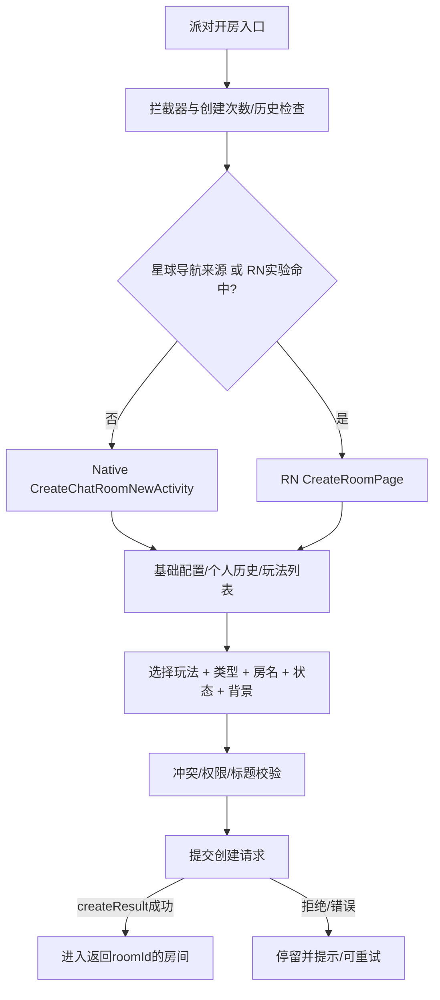

# Soul 中国版 6.38.0：派对开房、玩法选择与房间设置逆向报告

调查日期：2026-10-15。目标：`cn.soulapp.android`，versionName **6.38.0**，versionCode **26092202**，ARM64。

**本次已恢复 Native 开房配置、房内设置／玩法选择及其主要请求契约，并补充恢复 APK 固定配置引用的 RN 房间状态页与 RN 开房模块。交付包括可审计代码／布局证据和离线交互 demo。它是静态证据支持的流程重建；尚无真实账号运行录像、Android 截图或服务端响应，因此不能把演示目录当作今天线上完整玩法列表，亦不宣称像素级复刻。**

GitHub交付的文本／二进制边界见 [PUBLICATION.md](PUBLICATION.md)；完整APK、二进制资源与大型原始Evidence保留本地。

## 交付入口

- [可交互 demo](demo/index.html)：通过本地 HTTP 打开，见 [运行方式](demo/README.md)。
- [房内设置／切换玩法详细报告](analysis/room-settings/REPORT.md)与[带原行号摘录](analysis/room-settings/EXCERPTS.md)。
- [UI 资源报告](analysis/resources/RESOURCE-FINDINGS.md)：20个核心布局、45个直接引用 drawable 文件副本、尺寸颜色与哈希。
- [RN 房间状态页报告](analysis/rn/STATUS-FINDINGS.md)与[可读 JS](analysis/rn/status-readable.js)。
- [RN 开房补充报告](analysis/rn/CREATE-RN-FINDINGS.md)：Hermes 94 模块反汇编／伪代码证据。
- [客户端玩法声明表](analysis/mode-catalog.json)、[证据与工具来源](analysis/PROVENANCE.json)、[验证记录](demo/verification.json)。

## 1. 目标身份、方法与证据分级

原始 APK：`Soul-CN-6.38.0-arm64-v8a.apk`，166,856,887 字节，SHA-256：

```
af8031d67553fade39e091576c88a6a9f67db3d863fdfcaaa5fe11ce51abf558
```

来源为 Soul 官网 64位下载入口，下载记录与 `.metadata.json` 在本目录。ZIP 各成员 CRC 已通过。签名验证未执行。

| 标识 | 证据内容 | 可支持与不可支持的结论 |
|---|---|---|
| E-APK | `analysis/evidence/rea-artifact.json`，REA Evidence `ev_f0be4823c90b0a266ded291c46b4fc9d49bf32f297219c319ce8f56a9aaa6e6d` | APK 身份、归档成员与静态图；不证明真实运行 |
| D-JAVA | `analysis/java/`，已有 JADX 1.5.6 从本 APK 选择性生成的代码 | 事件处理、模型、请求声明等反编译推导；不是官方源工程，部分方法控制流损坏 |
| D-RES | `analysis/resources/` 的原文副本与 `sha256-manifest.json` | 布局、文案、尺寸、颜色与声明的初始可见性；不能单凭资源存在判定路径可达 |
| D-RN | `analysis/rn/provenance.json` 与本 APK `assets/pre_download/rn_bundle_config.json` | 按 APK 固定 URL 下载的两个补充包，**bundle member MD5** 与配置匹配；ZIP 本身 MD5 是另一作用域 |
| E-RN | `analysis/evidence/rea-rn-status.json` | 对房间状态 JS 的真实 REA 静态分析（ev_ebe60328f459020dc153ed82b340cec54b894245e01b27d474bb8921ca8ef913）；图覆盖不完整及尾部解析限制保留，具体 UI 行为由可读代码核对 |
| H-RN | `analysis/rn/module-index.json`、`disassembly/` | RN 开房 HBC 模块、函数、指令与伪代码；伪代码不是可运行恢复工程 |
| DEMO | `demo/` | 本地原创流程重建、示例目录及模拟响应；不作为原 App 行为证据 |

Android 专用 REA 操作因未配置 `jadx-headless-mcp 0.7.1` JAR 返回 capability_unavailable，原始错误保存在 `rea-android-package.json`。没有把普通 JADX 输出包装为 REA Evidence。使用机器已有 JDK/JADX，未安装或升级 Java／Android SDK，未改 REA 的全局配置。没有启动 Soul、连接设备、登录账号、申请实际麦克风权限或调用房间业务接口。

## 2. 首先区分三组容易混淆的选择

1. **玩法模式**：`playType`、`funcType`、`groupType`、`techType` 等决定玩法宿主和切换方式。
2. **派对类型**：`classifyCode` 是独立分类；房主可单独选择，部分玩法切换也可通过历史配置的映射更新类型。
3. **房间状态**：`privateStatus` 是公开／关闭推荐分发／仅挚友等可见性与准入意图。

它们分别有控件、模型与提交字段。不能把“选一个派对类型”直接视为“切换游戏”，也不能把隐藏推荐直接视为密码房。

## 3. 开房入口与版本内分流

常规 route `/chat/createChatRoom`（兼容 `/im/createChatRoomActivity`）先经 `CreateChatRoomInterceptor`，再进入 `CreateChatRoomRouter`。Router 会读创建次数限制与个人历史；次数不足不会继续普通开房流程。

**重要：本包并非只有一个开房页面。** `CreateChatRoomRouter.Y():1143–1155` 显示：来源为 `PLANET#NAVIGATIONBAR#CREATE_ROOM` 时转 RN；其他来源在 `util.e.h()` 的实验 `218817 == 'a'` 时也转 RN；否则启动 `CreateChatRoomNewActivity`。RN 页为 `soul_rn_club_party` 的 `CreateRoomPage`，传历史、剩余次数、来源、默认 tab／玩法／类型等参数（Router `Q():882–968`）。

同包还残留旧创建 XML，**不据其存在将旧版控件混入当前页面**。Native/RN 两条分支可静态确认；实际账号命中分流和热更新状态未知。



图中共同结构是两种实现的归纳；不能据此推定 RN 与 Native 每个校验顺序完全相同。RN 的细节见补充报告。

## 4. Native 开房页面的交互结构

### 4.1 顶部 Tab 与模式栏

`CreateChatRoomNewActivity:1009–1040` 对应：

| 显示标题 | tabCode | 选择形态 |
|---|---|---|
| 派对 | yuliao | 使用该 tab 配置的首个模式 |
| 开黑 | youxi | 受 `create_room_page_game_tab_switch` 控制；单独横向游戏栏 |
| KTV | ktv | 使用该 tab 配置的首个模式 |
| 玩法 | wanfa | 横向模式图标，单选、选中描边 |

开黑启用时顺序是**派对 → 开黑 → KTV → 玩法**；关闭时移除开黑。`k30/b.java:a()` 客户端读取该开关的回退值为 true，但服务端最终值未知，不把它当已观察的线上显示。

目录来自 `RoomConfigListModel → TabConfigData.playTypeConfigList`，每项含 name、playTypeCode、iconUrl、tagIconUrl、previewBackground、techType 等。Native 列表先与本地 handler 对照；有 groupType 特殊匹配，不能简单把客户端常量表等同于服务端全部目录。

选择项目会清除同栏其他选中态，再更新类型映射、推荐标题／话题、预览动画、FM／唱片机入口等（Activity `V0():1725–1756`、`o0():2477–2523`）。这不是只换一个高亮边框。

初始选择有明确参数／历史／首项优先逻辑；不是固定默认 KTV。默认 tab 可由显式 defaultDisplayTabCode/defaultTabCode、音乐大厅来源、上次玩法映射决定（`y0():2903–2962`）；具体目录缺失时会撤掉对应 tab。标题被手动编辑后，部分推荐更新会停止覆盖它。

### 4.2 房间信息与派对类型

- 房名单行上限15个 UTF-16 代码单元；原始 Native 提示“输入派对名，AI帮你生成或润色”。AI／随机推荐有请求，不是纯本地随机字符串。
- “派对类型”是底部两列单选弹层；内容来自 RoomTypeBean 列表。点击类型更新 classifyCode，关闭弹层；代码可再更新推荐标题。
- 主题／推荐话题另有横向列表与更多入口，依 supportedClassifyList 决定是否出现。
- 背景从配置加载、支持历史选中及默认项；previewBackground 可单独为 Lottie URL。远端照片／动画未冒充本地完整资源。
- `playType=18`（挚友小屋）向状态页提供“仅挚友”资格；`playType=23`（树洞）隐藏 FM 控件。是否显示更多创作入口还受开关控制。
- FM 项并非始终同义：非唱片机分支打开 FM 号码选择；配置含 `live_song` 时可成为唱片机开关，并受 `ModeConflictConfiguration` 限制，冲突提示“当前互动玩法和唱片机冲突，无法开启”。

### 4.3 创建按钮与请求顺序

`n1():2450–2475`：按钮需房名非空且不超过15、classifyCode≠0、backgroundId非空；classifyCode=7 还需非零 topicId；默认占位标题 tag 也会阻止提交。

点击后检查正在语音通话／其他派对等冲突，再申请麦克风权限；拒绝时不进入创建。部分娱乐拍拍／超凡拍战条件有专用提示。通过后先校验标题，再提交创建。`CreateChatRoomViewModel.b` 增加来源与可选 groupId/uiType，`ISoulHouse.createChatRoom` 声明 POST `live/create`，成功处理检查 `createResult`，才以返回 roomId 进房。

| 字段 | 来源或含义 |
|---|---|
| roomTopic | 房名 |
| classifyCode | 派对类型 |
| hotTopicId | classifyCode=7时使用主题值，否则0 |
| backgroundId | 所选背景 mediaId |
| playType | 当前选中的模式 code |
| fmCode / recTopicId | FM、推荐话题（可缺省） |
| privateStatus | 房间状态 |
| functionCodes | 例如唱片机 `live_song`；与主 playType 分开 |
| ext | 来源、可选群组和 UI 信息 |

这张表是 Native 实现中可追踪的请求字段，不是抓包结果。标题校验的 Retrofit 注解为 POST `chatroom/validate/room-name`；原始 DEX 声明摘录另存 `analysis/evidence/room-name-contract.json`。

### 4.4 RN 开房分支：模式网格与额外校验

已从 APK 指定的 `soul_rn_club_party` **4.82.21** bundle 恢复348个 Hermes94 模块的结构，选择12个相关模块反汇编；主创建页是模块10000171。不同于 Native 横向模式栏，RN 的玩法／开黑为**5列网格**，末尾补空位。它仍以 tabConfigList／playTypeConfigList 绑定目录，点选只改变配置，不发建房请求。

RN 派对类型 picker 标题“派对类型”，双列、点选立即回填并关闭；其中客户端兜底映射为1唱歌听歌、2心动速配、4闲聊唠嗑、6趣味辩论、10兴趣交流、5情感故事、7热门话题。它们是兜底，不证明服务器当前完整目录。背景 picker 为3列，含经典／精美／活动限定，区分预览、免费使用、已拥有、使用中与立即购买；购买回调和应用选择分开。

RN 输入提示“输入派对名称，AI帮你生成或润色”，长度15；输入变化后500ms去抖检查低质标题，创建前另经 Native checkMicPermission → validateRoomTopic → live/create → Native joinRoom。`code==1` 的权限分支是失败；创建 envelope `code=40002` 有受限账号提示，不能把所有HTTP成功都当创建成功。按钮有 trim 空标题检查及另一个零值条件，后者数据源在本次反汇编中尚未完整命名，不将 Native 的全部 gating 套入 RN。

视频玩法／投屏在 RN 有配置和平台条件，包里同时含明确 MOCK_* 测试资料。本次没有把 mock 视频目录或 iOS 系统录屏 picker 当作中国 Android 的实际展示。完整证据和行号见 [RN 开房报告](analysis/rn/CREATE-RN-FINDINGS.md)。

## 5. 房间状态：已恢复实际 RN 弹层

固定包 `soul_rn_room_status_setting` 4.60.72 的 JS 可读。开房页调起它，回传值进入创建草稿；房内设置页调起同一 RN 页后，Native 另提交 `live/room/updatePrivateStatusV2`，成功才更新房内状态。**RN 的选择回传与服务端写入成功是两个边界。**

| 状态 | 原文 | 交互与边界 |
|---|---|---|
| 0 | 所有人 | “所有人都可以看到并进入我的派对房间”；点击即时回传并关闭 |
| 1 | 关闭推荐分发 | “打开后本派对将不会出现在派对大厅及其他推荐场景”；不能推导为禁止其他人进入 |
| 2 | 仅挚友可进 | 需 globalInfo 开关和调用方 showOnlyFriendOption 同时通过字符串 `true` 比较；标题、副文案可远程覆盖 |
| 3 | 仅特定私聊对象可进 | 仅已有状态3时补入；该项 onPress 不回传、不关闭 |

状态0／1／2没有“保存”按钮；点击调用 callNativeAfterPop 并收起。点遮罩、返回／下拉仅退出，不产生新状态回传。布局为 #282828 底板、顶角12、68高选项、青色选中圆；拖拽 dy>100 关闭，默认动画250ms。详见 [RN 状态证据](analysis/rn/STATUS-FINDINGS.md)。

## 6. 房内设置与选择玩法

### 6.1 入口与角色

房内另有实验 `218596 == 'a'` 控制新 UX。命中时底栏显示“派对设置”图标并打开 `PartySettingContainerDialog`；未命中时旧玩法图标只对房主且 `createFrom != 4` 的路径可见。XML 的“原更多设置已移至左下角派对设置”是迁移提示，不证明每个账号都收到它。

新容器高为屏幕82%，底部展开，内部有子页返回栈。主面板按自己的 RoomUser.role 生成内容；**当前玩法卡片仅 role=1 可见**，role=3 和其他角色不能靠 demo 展示推定有房主权限。

房主面板分为快捷入口、当前玩法、用户管理、房间设置、其他设置。已恢复自助上麦、禁止所有人上麦、进场消息合并、屏蔽进场动画、房间状态、AI虚拟管家、礼物特效屏蔽等条目和条件。管理员及房客列表不同，完整矩阵与相关请求见 [房内报告 RS-03](analysis/room-settings/REPORT.md)。

### 6.2 玩法选择器

- 目录由 GET `live/playSetupList` 返回 `PlayFunctionBean`；最近玩法、全部玩法、分类列表都在响应模型内。
- 顶部最近玩法是较大图标行；下方“更多玩法”是48图标＋名称＋简介的纵向列表；右侧“全部玩法”可弹出分类选择。
- classifyType=0 使用全部目录，其他分类按 bizTypes 匹配。已开启项／含已开启子项的组在默认目录稳定前置。
- type=3 项是分组，打开二级页；标题取父 name，列表取 childGameSetups.playSetups，可另带运营 banner。**type=3 分组不等于切换操作号3。**
- 普通项目打开／关闭与冲突切换走不同分支。关闭常见确认“确认关闭…吗？”；冲突常见“确定切换为【…】？”和玩法关闭／结算提醒；不是点击任何模式就立即覆盖全部房间状态。
- `funcType=1` 主玩法与 `funcType=2` 附属功能分开建模。唱片机／音乐集市／随机话题等可更新自身开关而不替换房间主 playType；哪些组合实际兼容还取决于冲突配置。

### 6.3 不同玩法专用交互

| 客户端声明的模式 | 已追踪的特殊分支 |
|---|---|
| KTV | 比赛中关闭可先提示是否结束比赛 |
| 海龟汤 | 首次打开提示“是否开启海龟汤游戏？”、“下次一定 / 确认开启” |
| 欢乐PK | 专用开启确认；不是通用无提示打开 |
| 心动模式 | 进行中关闭提醒心动值与配对结果不保留 |
| 欢乐预言 | 助力阶段提示结算后再切换 |
| 冒险之雷 | canCloseGame=false时本局结束前不可关闭 |
| 速配模式 | status=1时不可关闭 |
| 音乐集市 | 有未演唱歌曲时不可关闭 |
| 超凡拍战 | 进行中提示等待结束或流拍 |
| 谁是卧底／你说我猜／Ai剧本杀／狼人魅影 | 本包存在客户端模式／handler；未验证本账号能创建、下载玩法包或完整运行规则 |

这不是全部玩法的完整互斥矩阵。`function/b0.a()` 的 JADX 代码含损坏控制流，不用其空值／分支错误推导精确全部匹配规则；专用 handler 和独立 API 可读部分分别举证。

### 6.4 主要切换契约

| 场景 | 打包声明 |
|---|---|
| 普通开关 | POST live/game/switch，roomId、playType、operateType；打开1／关闭2 |
| 冲突切换 | POST live/playModify，roomId、openType、openBizType、可选 extParams；openType取目录项目 type |
| 附属功能 | POST live/function/switch，roomId、bizType、operateType |
| 唱片机 | POST live/song/openMode，roomId、type；未开1／已开0 |
| 音乐集市 | POST music-fair/pattern/switch，outerRoomId、outerRoomType=chat_live、type |

真实更新还通过 LiveData 与房间状态／IM 消息进入 RoomFunctionSwitchManager 并更换 slice/block。没有运行证据，不将“发出切换意图”写成“服务器一定已切换”。

## 7. Demo 的重建范围

Demo 可从研究面板切换 RN／Native 开房分支：RN 五列网格与 Native 横向模式栏分别显示；派对类型均为两列即选。它演示开房 Tab、模式单选、15长度房名、派对类型、房间状态、背景、创建校验／失败重试、房内设置、玩法分类／二级目录、开启／关闭／冲突确认，以及角色和部分进行中限制。桌面研究面板展示字段与事件，并提供模拟分支开关。

**示例数据**：模式目录组合／顺序、分类名称、默认值、最近记录、背景、头像、麦位、游戏舞台、AI换名、远程页面和所有服务端响应。模式名／数值有客户端声明出处，但不等于线上服务端目录。研究面板本身是 demo 工具，不是 Soul 产品原界面。Demo 不采集声音、不真实开房、不连接业务服务。

20项状态测试通过，覆盖事务、取消／失败、角色变化、RN即时状态回传、专属确认、付费背景未拥有保护及RN切tab时的状态联动；Chrome浏览器走查通过9组流程检查，390／320宽度未出现横向溢出，未发现脚本异常、失败请求或外部业务请求。测试只验证demo自身。它们不建立 Soul 实机／多人／语音／真实账号验收事实。具体结果见 [验证记录](demo/verification.json)。

## 8. 覆盖清单与剩余未知

| 原问题 | 结果 | 仍需何种证据 |
|---|---|---|
| 开房流程 | 静态已回答 Native；RN 路由与固定模块补充追踪 | 真账号入口命中、热更新覆盖、服务器资格与返回值 |
| 选择不同模式 UI | 结构、绑定字段、单选、预览与类型联动已回答 | 实际目录顺序、远程图标／背景、所有模式运行屏幕 |
| 房内设置 | 容器、角色矩阵、关键条目与状态回调已回答 | 当前账号全部条件项、服务端最终授权 |
| 房内选择玩法 | 一级／二级／分类／最近／确认与主附功能分离已回答 | 所有互斥组合及每个游戏阶段动态验证 |
| 分析报告与 demo | 已交付，可本地运行 | 原 App 像素一致性、在线多人和语音体验未验证 |

可继续验证的最短路径：在合法可用的测试账号／Android设备上记录实际开房入口 → 选择若干不同模式 → 创建 → 左下设置 → 切换玩法／修改状态；对比这里的状态、目录与确认路径。当前交付不把这些尚未发生的观察填充为结论。
