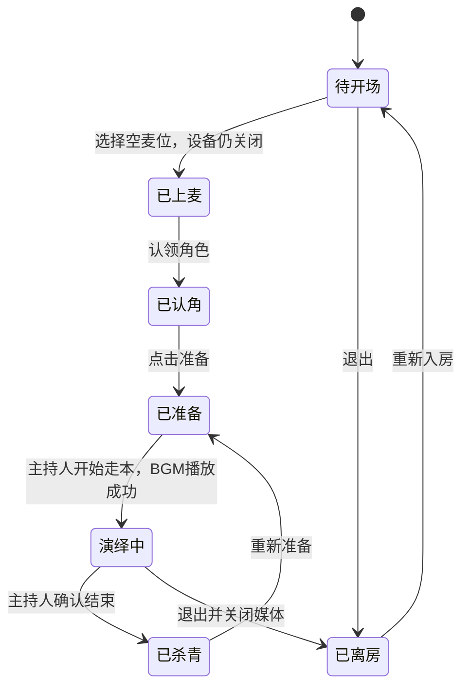
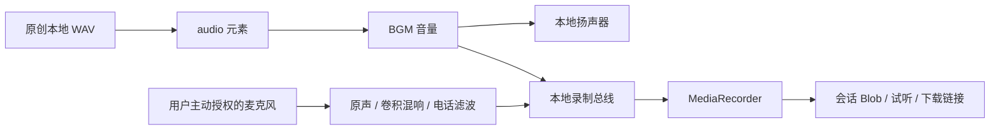

# Pia 戏核心交互与前端重建

## 本次交付

本次复用 REA 的同一 APK 身份、Manifest、类清单与壳层反编译证据，进一步解析 `resources.arsc`。原始来源与索引在 [PIAXI-EVIDENCE.md](PIAXI-EVIDENCE.md)。新增一个可以实际播放 BGM、处理本地麦克风和录制音频的前端房间演示。

**这是基于静态观察与公开教程的交互重建。** 原版业务代码受网易加固遮蔽，原版布局、事件处理器、同步算法及服务端协议尚未恢复。没有运行 APK，也没有连接戏鲸账号或后端。

## 交互证据与实现取舍

| 交互 | 证据 | 演示如何实现 |
|---|---|---|
| 选本、开 Pia | REA Manifest 的 BeginPia / ArticleAct / RoomMain；资源值“选本开Pia”“请选择你的角色” | 两个原创短本；换本保留麦位，重置角色、进度与音频。这个具体重置规则是设计选择。 |
| 麦位与静音 | RoomMicService；上/下麦、开/闭麦文案；抱人上麦提示提到默认关闭麦克风 | 六麦位，其中三个为演示人物。上麦不会自动请求设备权限；角色在上麦后认领。麦位数与绑定规则属于设计选择。 |
| 主持 BGM | [戏鲸-小激灵的 BGM 指南](https://aipiaxi.com/article-detail/914)介绍主持切换曲目、拖进度及快进快退 | 主持人可播放、暂停、切曲、拉 B；演员身份可阅读、调本地音量及人声效果。身份只是本地演示开关。 |
| 缓存 | 官网社区的[萌新教程](https://www.aipiaxi.com/article-detail/91054)描述缓存后播放 | 从本地服务读取 WAV 到浏览器内存。刷新失效；没有下载平台曲库或持久离线包。 |
| 音效时间戳 | [时间戳教程](https://www.aipiaxi.com/article-detail/441689)说明音效关联 BGM 和确认跳转；APK 中有时间轴、跳转文案 | 每个音效明确绑定 trackId 与秒数，确认后可跨曲跳转；播放/暂停状态保留。 |
| 原声、R&B、电话音 | BGM 指南描述混响、电话音以及恢复原声 | 使用 Web Audio 卷积混响或 400–2800 Hz 带通滤波，作用于本地录音人声。不是恢复 Agora 原版 DSP 参数。 |
| 剧本阅读与角色提示 | APK 的角色选择、角色提示、剧本进程文案 | 高亮自己的角色；点击台词标记当前行；可调字号。按 BGM 音效点跟随段落，不是语音识别跟读。 |
| 本地录音 | APK 有录制、录音管理及跳转覆盖文案，但模式归属不确定 | MediaRecorder 记录本地 BGM，若用户主动开启麦克风则合入人声。支持会话内试听与下载链接。 |
| 录制期间跳转 | APK 文案提示某 Pia 进度跳转会覆盖原录音，具体模式和覆盖粒度未知 | 本演示拒绝录制中的拉 B、切曲、切本；须先结束录音。这是明确的重建设计差异。 |
| 结束 / 杀青 | APK 包含 Pia 杀青、统计、伙伴与剧本资源，以及时长门槛提示 | 主持人确认结束后停止音频与麦克风，结束本地录制，显示经过时长和角色台词数量。不模拟奖励、门槛或实际演绎评分。 |
| 公屏与退出 | APK 有房间通知、公屏相关文案与 RoomService | 消息只写本页；退出停音频、关闭麦克风并结束录制。重新入房清空房间状态，已有会话录音保留。 |

教程证明产品描述，不等于观察到 3.56.1 的执行。APK 同时打包不同 Pia、beta、quick、轮读与陪练文案；没有把这些资源混成同一个原版状态机。未实现待 Pia 队列、麦序轮读、幕序轮读、管理员抱人、真实多人、云端录制或字幕识别。

## 演示的状态与职责

以下状态机属于演示设计：

播放、录音与麦克风状态独立于演绎状态：BGM 可在开场前试听；演绎中可暂停音乐；录音是主动开启，不随“开始走本”自动启动。时长统计是开始与结束之间的经过时间，包含音乐暂停时间；台词数来自原创剧本，并不证明用户念完了这些台词。

- [model.mjs](demo/model.mjs) 拥有本地角色、麦位、身份权限和演绎状态规则。预期失败用带 `room_rule` 标签的 Result 表达。
- [audio.mjs](demo/audio.mjs) 拥有音频元素、AudioContext、缓存 URL、麦克风轨道和每次 MediaRecorder。切本即使共用音轨也会显式归零；各录音回调持有各自录制器。
- [app.mjs](demo/app.mjs) 编排 UI 与媒体。房间离开使固定的手机播放器也不可操作；待授权麦克风若失去有效会话，其轨道会被关闭。
- [server.mjs](demo/server.mjs) 只监听 `127.0.0.1`，支持 WAV 的 Range 请求。没有依赖安装、外部脚本、分析埋点或业务网络请求。

媒体图：

麦克风没有连接扬声器，避免默认耳返啸叫；“混响/电话音”处理录音总线，不改变其他演示人物的声音。没有 RTC、远端听众或网络音频发送器。

## 运行与验证

运行：[demo/README.md](demo/README.md)。当前预览：[http://127.0.0.1:4186](http://127.0.0.1:4186)。退出当前本地服务器后可以按 README 重启。

| 验证层 | 本次结果 |
|---|---|
| 独立状态测试 | 6 项通过：上麦与认角、身份权限、切本重置、退出、开始与杀青、录制期间进度保护与无效选择器 |
| JavaScript 语法 | app、model、audio、server 均通过 Node 检查 |
| 桌面受控浏览器 | 上麦、认角、准备、播放/暂停、缓存、跳 B、演员禁用控制、录制、杀青、切本与重入均已操作验证 |
| 媒体对象 | BGM 实际加载并播放；64/48 秒媒体时长；跨曲确认跳转到约 4 秒；MediaRecorder 生成非空 Blob 与试听控件 |
| 同音轨换本 | 从雨夜第二曲切到灯塔共享曲目，媒体暂停且进度归零，角色清空 |
| 响应式 | 1280×720、390×844、320×568；手机未出现横向溢出，短桌面舞台全部核心控件无需侧栏滚动 |
| 浏览器错误 | 本次所检查的演示页面日志未返回 error/warn |
| 设备与真实人声 | 未验证麦克风权限、设备占用、真实人声混响/电话音效果或耳机听感 |
| 文件下载 | 已生成可下载链接；浏览器工具等待下载事件超时，未验证下载文件落盘完成 |
| 原版 / 多人 / 后端 | 未执行 APK，未验证原版画面、多人 RTC、跨端同步或服务端协议 |

预览与检查记录在 [demo/verification](demo/verification/README.md)。这些验证覆盖重建前端，不证明与原版行为等价。原始 APK 与全部先前 Evidence 保持原样；本次未提交、推送或部署。
