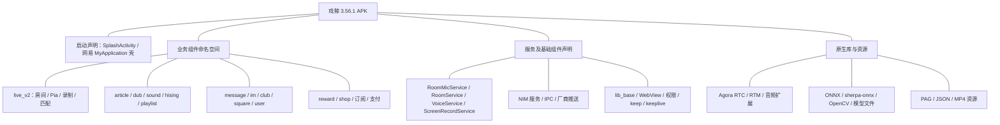

# 戏鲸 Android APK 模块与架构静态分析

分析日期：2026-10-12（Asia/Tokyo）。工具：REA 6.4.0 + jadx-headless-mcp 0.7.1。调查对象是官网下载的默认渠道 APK，未安装、未执行，也未连接它的后端。

## 结论与覆盖范围

戏鲸 APK 呈现出以 Android Activity / Service 为入口、按业务命名空间组织的客户端结构，包含房间/Pia 戏、配音、剧本、声音训练、消息、社团、用户和商业化等组件。包内同时存在 Agora RTC/RTM 原生库、网易云信组件、录音/播放/录屏服务、PAG 动画及本地推理库。

**当前完成的是包体与声明层架构分析，业务方法调用图和运行时架构仍未恢复。** APK 使用网易加固，REA 的全类查询只返回 31 个可见类，主要为 `com.netease.nis.wrapper.*`。不能把“类清单覆盖 complete”理解为原业务代码已完整反编译。

本报告用“观察”表示直接来自包体或 REA 的事实；“推断”表示根据名称或多项证据整理的候选解释；“未知”表示证据不足。业务包分组不等同于真实 Gradle 模块、依赖方向或服务端微服务。

## 1. 包体身份与来源

| 字段 | 核验结果 |
|---|---|
| 来源 | [戏鲸官网](https://www.aipiaxi.com/) → 下载页的公开安卓链接 |
| 原始 URL | `https://static.aipiaxi.com/app/android/xiya-latest.apk` |
| 本地 APK | [xijing-3.56.1.apk](xijing-3.56.1.apk) |
| 包名 | `com.piaxiya.app` |
| 版本 | `3.56.1` / versionCode `35601` |
| 渠道声明 | `CHANNEL=default` |
| 大小 | 264,160,728 字节，约 251.9 MiB |
| SHA-256 | `ad679dd87079e5bc173e3abf64931f1da29ad3ad753c23702d68b901c70e5769` |
| minSdk / targetSdk | 24 / 36 |
| 签名认证 | 未验证 APK 签名证书、开发者签名链或历史签名一致性 |

版本来自实际 Manifest，不使用商店网页版本作为包体版本。`latest.apk` 是可变链接，未来下载可能不同；本地摘要固定本次调查对象。保存的 [provenance.json](source/provenance.json)、官网页面、下载组件及 HTTP headers 可追溯链接发现过程。小米网页本次下载返回维护页，最终使用官网包。

## 2. 声明层模块

观察：Manifest 声明 **531 个 Activity、48 个 Service、27 个 Receiver、17 个 Provider**。`com.piaxiya` 命名空间下分别为 509、16、5、2 个；该归属只基于命名空间。下面的数量统计涵盖 `com.piaxiya.app` 下各类组件，并不是源码类数量。

| 业务组 | 代表性声明 | 根据名称推断的职责 |
|---|---|---|
| 启动与首页 | `SplashActivity`、`home.activity.MainActivity` | 启动、首页；页面切换顺序未知 |
| `live_v2` | `CreateRoomActivity`、`BeginPiaActivity`、`RoomMainActivity`、`RoomMicService` | 房间、开戏、麦克风、房间生命周期候选 |
| `article` | `PiaXiSearchActivity`、`ArticleDetailActivity`、`ArticleActActivity`、series/timeline/rank | 剧本检索、详情、演绎、系列与排行候选 |
| `dub` | `DubRecordActivity`、`DubAdjustActivity`、`DubPreviewActivity`、`DubDraftsActivity`、`VideoBgmCutActivity` | 配音录制、调整、预览、草稿、BGM 剪辑候选 |
| `sound` | training/mandarin/identify/masked/drift/partner_ai | 声音训练、普通话、识别、蒙面与漂流等候选 |
| `sound.partner_ai` | `TrainingPartnerPracticeActivity`、`TrainingPartnerCallActivity` 等六入口 | AI 陪练产品界面候选；模型、供应商、会话协议未知 |
| `message` 与 `com.piaxiya.im` | `ChatContentActivity`、`GroupDetailActivity`、session/contact | 私聊、群聊、联系人及消息 UI 候选 |
| `club`、`square` | club/activity、square/activity | 社团、内容社区候选 |
| `user` | login/personal/relationship/setting/task/subservice | 登录、个人页、关系、设置、任务、订阅候选 |
| `reward`、`shop` | `PaymentActivity`、`RechargeActivity`、`WXPayEntryActivity`、支付宝 Activity | 充值、支付、礼物及商业化候选 |
| `playlist`、`hising` | playlist/activity、`HiSingActivity` | 播单及演唱候选 |
| `lib_base`、`common` | `CommonWebViewActivity`、权限/相册/录屏/keep/keeplive | 公共 UI、媒体和后台支撑能力候选 |

更细的声明数量：

| `com.piaxiya.app` 一级名称 | 组件数 |
|---|---:|
| `user` | 132 |
| `sound` | 55 |
| `live_v2` | 54 |
| `dub` | 46 |
| `message` | 45 |
| `club` | 37 |
| `article` | 26 |
| `reward` | 21 |
| `square` | 20 |
| `shop` | 18 |
| `lib_base` | 16 |
| `playlist` | 12 |
| `hising` | 8 |
| `common` | 7 |
| `treasure` | 5 |
| `service` | 4 |
| `test` | 4 |
| `carefully` | 4 |
| `island` | 4 |
| `home` | 2 |
| `wxapi` | 2 |
| `game` | 2 |
| `view` | 1 |
| `push` | 1 |
| `utils` | 1 |
| `(root)` | 1 |

详细组件与 Intent Filter 在 [manifest-summary.json](evidence/manifest-summary.json)，原始解码 XML 在 [AndroidManifest.xml](AndroidManifest.xml)。名称中出现 `live_v2` 或多个 V2 Activity 不足以证明模块替代关系或版本迁移状态。

## 3. 架构视图

下图是声明与打包归类，连线表示分组，**不表示调用或数据流**。

推断：可将它理解为“业务页面 + 后台媒体/消息服务 + 原生 SDK + 公共能力”的分层候选。原始模块间依赖、状态管理、MVVM/MVP、DI、数据库及 API 客户端组织尚无代码证据，不应从包名猜定。

## 4. 房间、音频与消息

**观察：前台服务分工在 Manifest 中直接可见。**

| 服务 | foregroundServiceType / process |
|---|---|
| `live_v2.service.RoomMicService` | microphone、mediaPlayback |
| `live_v2.service.RoomService` | mediaPlayback |
| `service.VoiceService` | mediaPlayback |
| `sound.masked.service.MaskedHeartService` | microphone、mediaPlayback |
| `lib_base.media.screenrecord.ScreenRecordService` | microphone、mediaProjection；stopWithTask=false |
| `service.SubmitService` | dataSync |
| `NimService`、`NimService$Aux`、`NIMJobService`、`NIMContentProvider` | `:core` 进程声明 |
| WatchDog / JobScheduler | `:watch` 进程声明 |
| keeplive `RemoteService` | `:remote` 进程声明 |

观察：打包 `libagora-rtc-sdk.so`、`libagora-rtm-sdk-jni.so` 和多种音频/视频扩展；Manifest 包含网易云信 `nimlib` 服务、IPC Provider、混合推送 Receiver/Service 和 appKey 元数据，assets 有 `nim/` 资源。

推断：Agora 是实时音视频/消息候选，云信是 IM/推送候选；它们可能按房间与聊天场景分工，也可能有兼容或备用逻辑。**当前无法确认 Agora RTM 是否参与房间同步、云信是否负责全部聊天，或当前使用哪个音频通道。**

未知：入房鉴权、RTC token 获取、上麦状态机、混音策略、BGM 时间同步、云端录制、断线重连、消息去重、房间权威状态、传输协议以及后端拓扑。服务类型只是系统声明，不证明麦克风已开启或录制正在发生。

## 5. 包体构成及其他 SDK

| 观察 | 数量／原始未压缩字节 |
|---|---:|
| ZIP 成员 | 10,279 |
| 解压后成员总大小 | 476,889,220 |
| DEX | 1 个 classes.dex，62,114,360 |
| 原生 .so | 132 个，311,551,796 |
| arm64-v8a | 65 个库，184,024,464 |
| armeabi-v7a | 67 个库，127,527,332 |
| assets | 230 项，38,119,067 |
| res | 9,623 项，55,470,596 |

132 库包含双 ABI 的重复实现，不能视作 132 个独立 SDK。原生库约占未压缩成员总大小的 65.3%；这不是下载流量占比。

- **实时媒体候选**：48 个 `libagora*` 库合计 144,589,980 字节，含 RTC/RTM、降噪、回声消除、空间音频等命名扩展。是否启用各扩展未知。
- **推理和视觉候选**：打包 `libonnxruntime.so`、`libsherpa-onnx-jni.so`、`libopencv_java4.so`；模型资源包括 MNN/Caffe，以及 blink、mouth_gaze、detect 名称。只支持本地推理/视觉能力候选，不能确认 AI 陪练采用这些模型。
- **语音识别候选**：`libmsc.so` 与 `assets/iflytek/recognize.xml`、BNF/ABNF、WAV 共同出现。recognize.xml 尚未解码，实际识别链路未知。
- **动画和媒体资源**：`libpag.so`，88 个 PAG 文件、59 个 JSON、7 个 MP4。资源名包括房间、配音、声波、礼物、匹配、狼人杀等；不能直接当作可达产品功能。
- **存储/传输候选**：`libmmkv.so`、`libconscrypt_jni.so`、`libquicclient-jni.so`、`libtnet-3.1.14.so`、`libfusionstorage.so`，以及 okhttp 公共后缀资源。MMKV、HTTP/QUIC 的实际使用位置未知。
- **明确的 SDK 声明**：Glide 的 OkHttp/WebP 模块、SVGA 兼容模块、微信支付回调、支付宝 Activity、极验 OneLogin、友盟与多厂商推送、SensorsData 元数据。具体初始化和采集行为未知。
- **配置解析**：supplierconfig.json 有 vivo/xiaomi/huawei/oppo 四 supplier；Aria 普通下载配置 threadNum=1、maxTaskNum=1、reTryNum=5。是否生效未知。

限定于完整 ZIP 文件名检索，未找到 Flutter、Unity/IL2CPP、Cordova、React Native 常见 bundle/hermes 标记。结合大量 Activity 声明，可以提出原生 Android 主客户端的候选判断；加固与动态加载使该阴性检索不能排除任何被隐藏框架。

## 6. 加固与反编译覆盖

直接观察：

1. Application 声明为 `com.netease.nis.wrapper.MyApplication`。
2. REA 全类清单返回 31 个类，主要是网易 wrapper，另有字符串工具和 Kotlin DebugProbes。
3. REA 反编译 `attachBaseContext` 可见 `MyJni.load(this, packageName)`、原生库加载、`newApp = a(context)`、`MyJni.ra(context, newApp)` 等。说明可见启动代码经过壳层原生逻辑并委托 Application；未观察实际执行。
4. DEX header 的 file_size 与 62,114,360 字节精确一致，class_defs_size=30；REA 清单与原始 DEX 表数量采用不同表示，不能强行要求相等。
5. 声明 data 区结束于偏移 102,568，之后的 62,011,792 字节仍在 file_size 内，其格式未解释。扫描未找到第二个标准 DEX 魔数，不等于这些字节不含业务数据。
6. assets/neasogg.ogg 与 nedata.db 不是标准 Ogg/SQLite 文件头，前四字节同为 1eee5a96；真实格式未知。

派生核验：DEX 内部 SHA-1 与 Adler32 匹配，只验证该 DEX 的内部校验一致，不验证 APK 开发者身份。

因此，不能提供可信的业务源代码、业务方法调用图、完整类依赖或网络 API 清单。静态 JADX 的成功结果不表示已脱壳。原生壳加载与协议细节未反编译；没有修改包体，也没有构造替代 APK。

## 7. 声明层系统边界

观察：`SplashActivity` 为 LAUNCHER，另声明 `piaxiya://` 多个路由（如 living_room、article_detail、club、webview），以及 v.aipiaxi.com HTTP/HTTPS App Link。autoVerify=true 是声明，不证明设备验证通过。

观察：Application debuggable=false、allowBackup=false；声明 usesCleartextTraffic=true 且引用 networkSecurityConfig。未解码该网络安全配置，不能断定所有域名允许明文，也不能断定线上流量采用明文。

Manifest 声明录音、媒体、通知、相机等权限，还含部分系统级 CAPTURE 权限。声明权限不代表普通安装能获得权限，也不代表用户已授权或对应能力可用。

## 8. Evidence 索引

| 文件 | REA Evidence ID / 来源 | 内容 |
|---|---|---|
| [package.json](evidence/package.json) | `ev_57bae33db790c42ad9ca35c75940da34dad7ca44a0537685a2330c078b0327a0` | APK 身份、完整 Manifest、声明覆盖限制 |
| [classes.json](evidence/classes.json) | `ev_e7c6b988dd88b9943722d7127977561f4e6c4481c714f487056cef2e25d1fa21` | 全部可见类与查询边界 |
| [artifact.json](evidence/artifact.json) | `ev_ce3dcbb861f367a66418f698dd9e2c7fe2947b5b5429c902a4e26d8d238dd32f` | REA 制品图与内容摘要；内含各子步骤 Evidence |
| [wrapper-class.json](evidence/wrapper-class.json) | REA inspect_android_class | 壳层成员与签名清单 |
| [wrapper-attach.json](evidence/wrapper-attach.json) | `ev_dcdc90eea35b74c64d951a1423fb6b6668024949ae3b690ed4b6dc089821a5db` | 启动方法静态反编译 |
| [wrapper-load.json](evidence/wrapper-load.json) | REA inspect_android_method | loadLib 方法 |
| [manifest-summary.json](evidence/manifest-summary.json) | 从 package Evidence 的 XML 派生 | 组件分组与 Intent Filter |
| [archive-inventory.json](evidence/archive-inventory.json) | Python zipfile 派生观察，非 REA Evidence | 完整成员、大小、资源与原生库归类 |
| [dex-header.json](evidence/dex-header.json) | Python 格式解析，非 REA Evidence | DEX 表与校验、未知区域、assets 头部 |

REA Evidence 内保留下载后的原始 /private/tmp 目标路径，未篡改其 provenance。仓库 Xijing 下文件是同字节副本，摘要相同；最终交付前再次核对 APK 摘要。全部为本地调查产物，未提交、推送或部署。

## 9. 调查问题闭环

| 问题 | 状态 | 证据边界 |
|---|---|---|
| 找到可分析的戏鲸 APK | 已回答 | 官网 URL + 实际包名/版本/摘要 |
| 主要产品模块 | 部分回答 | Manifest 入口和资源命名；功能执行不可证 |
| 客户端组件/进程结构 | 声明层已回答 | 组件类型、前台服务类型、进程声明 |
| 实时音频/IM SDK | 打包层已回答，实际分工未知 | Agora 库 + 云信声明与资源 |
| 业务类与调用关系 | 未解决 | 加固只暴露壳层类 |
| 后端架构与协议 | 未解决 | 本次无网络/运行时证据 |
| 动态行为与真实设备 | 未验证 | 未执行 APK |

进一步确认需要同版本未加固包，或受控 Android 运行时观察：先观察入房、上麦、播 BGM、消息和录制流程，再核对库加载、进程、日志和网络证据。它们是后续需要的证据类型，本次没有自动安装、运行、登录或请求业务 API。
